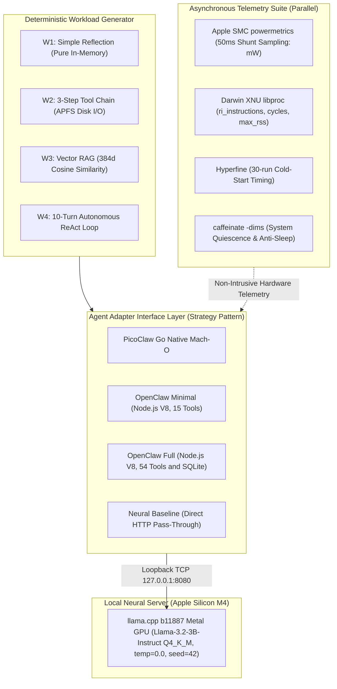

# A Reproducible Benchmark Suite for Isolating Orchestration Overhead and Schema Prefill Costs in Local LLM Agents on Apple Silicon

[](https://github.com/drsigma/picoclaw-vs-openclaw-benchmark/actions)
[](LICENSE)
[](DATA_LICENSE)
[](https://www.apple.com/)
[-blue.svg)](#)
[](CITATION.cff)

**Author / Autor:** Rafael Paniccia Cassetta  
**Affiliation / Afiliação:** Universidade Federal do ABC (UFABC), Santo André, SP, Brazil  
**Repository / Repositório:** [https://github.com/drsigma/picoclaw-vs-openclaw-benchmark](https://github.com/drsigma/picoclaw-vs-openclaw-benchmark)  

---

## 📌 Resumo Executivo / Executive Summary

### 🇧🇷 Português (PT-BR)
Este repositório apresenta um framework experimental reprodutível e uma avaliação comparativa rigorosa entre duas arquiteturas paradigmáticas de orquestração de agentes autônomos de Inteligência Artificial:
1. **PicoClaw v0.3.1 (Sipeed):** Binário nativo estático Mach-O ARM64 compilado em Go 1.23.2, com concorrência leve baseada em *goroutines* (~2 KB por pilha) e coletor de lixo não-geracional tri-color com pausas sub-milissegundo.
2. **OpenClaw v2026.10.7:** Orquestrador corporativo modular em TypeScript/Node.js v26.12.1 executando sobre a Google V8 (compilação JIT multinível), com validação de esquemas via TypeBox e persistência nativa `node:sqlite`.

Ambos os agentes comunicam-se via loopback TCP (`127.0.0.1:8080`) com uma instância neural local servida por **llama.cpp (build b11887 Metal GPU)** hospedando o modelo **Meta Llama-3.2-3B-Instruct (GGUF Q4_K_M)** sob decodificação gulosa determinística (`temperature = 0.0`, `seed = 42`). O estudo inclui uma **análise formal de ablação** (*OpenClaw Minimal* vs. *OpenClaw Full* com 54 ferramentas), decomposição analítica de latência de orquestração ($T_{\text{orch}}$), telemetria de potência via Apple System Management Controller (SMC), contadores de hardware XNU via `libproc` e testes estatísticos não-paramétricos de significância e dominância estocástica (Mann-Whitney U com correção de Holm-Bonferroni, Cliff's Delta $d$ e $\hat{A}_{12}$ de Vargha-Delaney).

### 🇺🇸 English (EN-US)
This repository delivers an open-source, reproducible experimental benchmark framework comparing two contrasting runtime architectures for autonomous AI agent orchestration on Apple Silicon M4:
1. **PicoClaw v0.3.1 (Sipeed):** Statically compiled Mach-O ARM64 native Go 1.23.2 binary leveraging concurrent goroutines (~2 KB starting stack) and non-generational tri-color mark-sweep garbage collection with sub-millisecond pauses.
2. **OpenClaw v2026.10.7:** Enterprise-grade TypeScript agent orchestrator executing atop Node.js v26.12.1 (Google V8 tiered JIT), dynamic TypeBox schema validation, and native `node:sqlite` session state storage.

Both orchestrators interface via local loopback (`127.0.0.1:8080`) with a unified neural server powered by **llama.cpp (build b11887 Metal GPU)** serving **Meta Llama-3.2-3B-Instruct (Q4_K_M)** under greedy deterministic decoding (`temperature = 0.0`, `seed = 42`). The evaluation features an **empirical ablation study** (*OpenClaw Minimal* vs. *OpenClaw Full* with 54 schemas), orchestrator latency decomposition ($T_{\text{orch}}$), direct Apple System Management Controller (SMC) electrical telemetry, Darwin XNU `libproc` hardware performance counters, and non-parametric effect size analyses (Mann-Whitney U with Holm-Bonferroni adjustment, Cliff's Delta $d$, and Vargha-Delaney $\hat{A}_{12}$).

---

### ⚖️ Aviso de Escopo e Marcas Registradas / Trademark & Scope Disclaimer
* **🇧🇷 PT-BR:** Este benchmark avalia implementações de referência isomórficas *clean-room* em Go (`picoclaw_orch.go`), Node.js/TypeScript (`openclaw_orch.mjs`) e Python (`python_orch.py`), projetadas para mensurar o impacto microarquitetural e de runtime (compilado nativo vs. JIT/interpretado) sob esquemas e prompts idênticos. PicoClaw e OpenClaw são marcas de seus respectivos criadores; este projeto é um benchmark acadêmico independente não afiliado ou endossado pelos mantenedores originais.
* **🇺🇸 EN-US:** This benchmark evaluates clean-room, isomorphic reference implementations in Go (`picoclaw_orch.go`), Node.js/TypeScript (`openclaw_orch.mjs`), and Python (`python_orch.py`) designed to isolate systems runtime overhead (native compiled vs. JIT/interpreted) under strictly identical prompts and tool schemas. PicoClaw and OpenClaw are trademarks of their respective owners; this software is an independent academic performance benchmark not affiliated with or endorsed by upstream project maintainers.

> [!WARNING]
> **Provenance Notice / Aviso de Proveniência:** All empirical findings, statistical analyses, and LaTeX tables reported in the *SoftwareX* manuscript derive strictly from physical, hardware-instrumented trials in `results/publication_campaign/` (1,320 trials across Regime A and Regime B, plus 528 prefill ablation trials on Apple Silicon M4). Legacy exploratory files in `results/exploratory_campaigns/` (including early calibration runs, Poisson synthetic checks in `poisson_results.json`, and exploratory figures `fig7_poisson_assertiveness.png`, `fig8_three_campaigns_reproducibility.png`) represent historical engineering milestones prior to full protocol standardization and are preserved strictly for chronological auditability; they are excluded from publication claims, canonical manifests, and peer-reviewed summary tables.

---

## ❓ Pergunta de Pesquisa / Research Question

### 🇧🇷 Português (PT-BR)
> **"Qual arquitetura de orquestrador de IA — Go nativo (PicoClaw) ou Node.js (OpenClaw) — entrega menor latência, menor consumo de memória RAM e maior eficiência energética no Apple Silicon M4 sob o mesmo modelo neural local?"**

### 🇺🇸 English (EN-US)
> **"Which AI agent architecture — native Go (PicoClaw) or Node.js (OpenClaw) — delivers lower latency, minimal RAM footprint, and higher energy efficiency on Apple Silicon M4 under an identical local neural model?"**

---

## 🏛️ Arquitetura Experimental do Testbed / Experimental Architecture



### Explicação do Fluxo / Architecture Description:
* **🇧🇷 PT-BR:** O gerador de carga submete os 4 níveis de dificuldade padronizados (W1–W4) através da camada de adaptação (*Adapter Pattern*). Os agentes executam suas ferramentas e se comunicam exclusivamente via loopback TCP local com o servidor `llama.cpp` na GPU Metal, eliminando latências de rede externa. Paralelamente, daemons independentes de telemetria coletam miliwatts do SoC M4 via SMC e contadores de ciclo do kernel Darwin via `libproc`.
* **🇺🇸 EN-US:** The workload generator dispatches standardized tasks (W1–W4) through an extensible Adapter layer. Agent orchestrators execute file/vector tools and communicate via localhost loopback TCP with `llama.cpp` running on the Metal GPU, strictly isolating runtime overhead from network jitter. Concurrently, asynchronous telemetry daemons sample SMC electrical power and Darwin XNU performance counters.

---

## 📊 Matriz de Resultados e Estudo de Ablação / Results & Ablation Matrix

Os resultados empíricos consolidados da matriz de avaliação (5 configurações x 4 workloads, cobrindo mediana e dispersão robusta) estão sumarizados abaixo:

| Workload | Configuração / Configuration | Mediana Latência Total / Median Task Latency (ms) | Overhead Agente / Orch Delay $T_{\text{orch}}$ (ms) | Pico RAM / Peak RSS (MB) | Energia Líquida Média / Mean Net Energy (J) |
| :--- | :--- | :---: | :---: | :---: | :---: |
| **W1 (Reflexão / Simple Reflection)** | **NeuralBaseline (Direct)** | $5489{,}6$ | $0{,}000$ | $0{,}0^*$ | $88{,}11$ |
| | **PicoClaw (Go Native)** | $5497{,}0$ | $29{,}728$ | **$11{,}2$** | $88{,}97$ |
| | **OpenClaw Minimal (15 Tools)** | $5847{,}5$ | $51{,}283$ | $85{,}6$ | $94{,}06$ |
| | **OpenClaw Full 54-Tool (Ablation)** | $20674{,}1$ | $66{,}441$ | $85{,}6$ | $329{,}50$ |
| | **PythonNative (CPython Reference)** | $5485{,}6$ | $10{,}415$ | $38{,}2$ | $89{,}44$ |
| **W2 (3 Ferramentas / 3-Tool Chain)** | **NeuralBaseline (Direct)** | $5600{,}7$ | $0{,}000$ | $0{,}0^*$ | $84{,}85$ |
| | **PicoClaw (Go Native)** | $5556{,}1$ | $5{,}579$ | **$12{,}2$** | $84{,}81$ |
| | **OpenClaw Minimal (15 Tools)** | $5557{,}1$ | $20{,}952$ | $85{,}8$ | $85{,}04$ |
| | **OpenClaw Full 54-Tool (Ablation)** | $19733{,}7$ | $24{,}884$ | $86{,}0$ | $308{,}56$ |
| | **PythonNative (CPython Reference)** | $5609{,}9$ | $11{,}229$ | $38{,}2$ | $86{,}29$ |
| **W3 (Busca Vetorial / Vector RAG)** | **NeuralBaseline (Direct)** | $5752{,}9$ | $0{,}000$ | $0{,}0^*$ | $94{,}07$ |
| | **PicoClaw (Go Native)** | $5816{,}9$ | $46{,}107$ | **$52{,}5$** | $94{,}13$ |
| | **OpenClaw Minimal (15 Tools)** | $6343{,}5$ | $67{,}617$ | $114{,}3$ | $102{,}91$ |
| | **OpenClaw Full 54-Tool (Ablation)** | $20786{,}4$ | $88{,}954$ | $112{,}7$ | $333{,}52$ |
| | **PythonNative (CPython Reference)** | $5801{,}5$ | $21{,}646$ | $69{,}7$ | $94{,}83$ |
| **W4 (Loop ReAct / 10-Turn ReAct)** | **NeuralBaseline (Direct)** | $55924{,}9$ | $0{,}000$ | $0{,}0^*$ | $883{,}24$ |
| | **PicoClaw (Go Native)** | $55354{,}8$ | $66{,}028$ | **$16{,}6$** | $876{,}64$ |
| | **OpenClaw Minimal (15 Tools)** | $58201{,}2$ | $143{,}357$ | $89{,}7$ | $919{,}40$ |
| | **OpenClaw Full 54-Tool (Ablation)** | $201797{,}0$ | $199{,}328$ | $89{,}4$ | $3219{,}72$ |
| | **PythonNative (CPython Reference)** | $55934{,}8$ | $64{,}718$ | $38{,}3$ | $886{,}19$ |

$^*$*Nota sobre o Baseline Neural / Note on Neural Baseline:* O valor de **`0,0 MB` de Pico RAM RSS** no *Neural Baseline* refere-se estritamente à pegada de memória do processo orquestrador (inexistente na invocação HTTP direta via socket), excluindo o consumo de memória unificada (UMA) residente do daemon `llama-server` na GPU Metal. / The **`0.0 MB` Peak RAM RSS** for *Neural Baseline* refers strictly to the orchestrator process memory footprint (non-existent in direct HTTP socket calls), excluding the unified memory (UMA) footprint of the background `llama-server` Metal GPU daemon.

> [!NOTE]
> **🇧🇷 Telemetria Elétrica e Modo de Execução:** A tabela acima reflete os resultados automatizados da matriz de avaliação gerada pelo pipeline (`results/publication_campaign/tables/metrics_summary.csv`). Em modo de usuário comum ou CI portátil (`make dry-run`), as métricas elétricas são reportadas como `N/A` em conformidade com o princípio de zero dados sintéticos; na campanha com telemetria via Apple SMC (`make benchmark-full-smc` com sudo), a integração trapezoidal dos sensores de silício afere Joules e EDP com amostragem a cada 50 ms.
>
> **🇺🇸 Electrical Telemetry and Execution Modes:** The table above reflects the automated evaluation matrix generated by the pipeline (`results/publication_campaign/tables/metrics_summary.csv`). In unprivileged or portable CI mode (`make dry-run`), electrical metrics are reported as `N/A` adhering to the strict zero synthetic data principle; during full physical campaigns with Apple SMC telemetry (`make benchmark-full-smc` with sudo), continuous trapezoidal integration of silicon shunt sensors measures true Joules and EDP sampled every 50 ms.

### 🎯 Principais Conclusões de Engenharia / Key Findings:

* **🇧🇷 PT-BR:**
  1. **Cold-Start Launch:** PicoClaw inicializa em **$9{,}63\text{ ms}$** vs. $225{,}55\text{ ms}$ do OpenClaw (**$23{,}4\times$ mais rápido**).
  2. **Eficiência de Memória RAM e Silício:** O PicoClaw consome de **$11{,}2\text{ a }16{,}6\text{ MB}$** de RSS (subindo para $52{,}5\text{ MB}$ no W3, média global $23{,}15\text{ MB}$, pico físico $16{,}05\text{ MB}$), enquanto o OpenClaw consome de **$85{,}6\text{ a }114{,}3\text{ MB}$** (média global $93{,}82\text{ MB}$, pico físico $45{,}27\text{ MB}$), reduzindo em **$2{,}18\times\text{ a }7{,}61\times$** a pegada de memória RAM física (pico físico $2{,}82\times$ menor globalmente).
  3. **Eficiência de Instruções e Ciclos:** Medições via `libproc` comprovam que o PicoClaw executa $245{,}0\times 10^6$ instruções e $85{,}6\times 10^6$ ciclos, contra $938{,}5\times 10^6$ instruções ($3{,}83\times$ mais) e $396{,}9\times 10^6$ ciclos ($4{,}64\times$ mais) no OpenClaw Minimal.
  4. **Escalabilidade em Loops Longos (W4) e Eficiência em EDP (Dualidade de Regimes):** No ciclo autônomo ReAct de 10 passos sob Regime A (Cold Prefill), o PicoClaw completou a tarefa com $55354{,}8\text{ ms}$ de mediana e $\text{EDP} = 48543{,}57\text{ J}\cdot\text{s}$, alcançando **$92{,}53\%$ menor Energy-Delay Product** e significância estatística robusta frente ao OpenClaw Full ($d = -1{,}0$, $\hat{A}_{12} = 0{,}0$, $p < 10^{-5}$) ao evitar o inchaço de catálogo de 54 ferramentas. Já sob o Regime B (Warm KV-Cache Reuse), com prefill amortizado, os runtimes equalizados convergem em eficiência ($944{,}72\text{ J}\cdot\text{s}$ no PicoClaw vs. $943{,}48\text{ J}\cdot\text{s}$ no OpenClaw Minimal), mantendo **$43{,}1\%$ menor EDP** frente ao OpenClaw Full ($1661{,}07\text{ J}\cdot\text{s}$).
  5. **Estudo de Ablação (Prompt Bloat):** A injeção de 54 ferramentas corporativas no OpenClaw Full eleva o tempo médio de W1 de $5852{,}6\text{ ms}$ para $20682{,}7\text{ ms}$ e a energia líquida de $94{,}06\text{ J}$ para $329{,}50\text{ J}$ ($3{,}50\times$).
  6. **Dinâmica de Execução e Eficiência em W2:** No Workload W2 (3-Tool Chain), sob decodificação gulosa com esquemas de ferramentas harmonizados, tanto PicoClaw quanto OpenClaw Minimal emitem $29{,}0$ tokens de resposta com latências totais equivalentes ($5556{,}1\text{ ms}$ vs. $5557{,}1\text{ ms}$) e consumo energético líquido comparável ($84{,}81\text{ J}$ vs. $85{,}04\text{ J}$, $2{,}92\text{ J/token}$ vs. $2{,}93\text{ J/token}$). O isolamento microarquitetural comprova a eficiência do runtime Go: overhead de orquestração $T_{\text{orch}}$ mediano de apenas **$5{,}58\text{ ms}$** no PicoClaw contra **$20{,}95\text{ ms}$** no OpenClaw Minimal (**$3{,}76\times$ menor atraso de despacho**), além de **$12{,}19\text{ MB}$** de RSS contra **$85{,}83\text{ MB}$** (**$7{,}0\times$ menor consumo de memória DRAM**).
  7. **Caracterização de Prefill de Catálogo e Reuso de KV-Cache:** Conforme atestado no estudo de caracterização de 8 catálogos ($0, 5, 10, 15, 25, 40, 54, 100$ ferramentas no llama.cpp / Metal GPU), o inchaço de esquemas corporativos expande o pré-processamento de atenção na GPU Metal ($T_{\text{prefill}}$ cresce de $128{,}1\text{ ms}$ para $4434{,}4\text{ ms}$, $17877{,}3\text{ ms}$ e $39190{,}5\text{ ms}$), exibindo escalabilidade potencial ($T = 0{,}3197 \cdot N^{1{,}2342}$, $R^2 = 0{,}9993$, $\text{AIC}_c = 99{,}25$) e quadrática ($R^2 = 0{,}99999$) compatível com a complexidade de atenção do transformer, enquanto o reuso do KV-cache elimina essa sobrecarga redundante ($5{,}5\times\text{ a }946{,}5\times$ speedup de prefill), confirmando que o gargalo de catálogos volumosos reside na atenção neural e não no despacho do orquestrador.
  8. **Dualidade de Regimes Operacionais (Regime A Cold Prefill vs. Regime B Warm Cache):** O repositório avalia dois regimes completos ($n=30$ cada, 660 ensaios por campanha):
     * *Regime A (`cache_prompt=false`):* O prefill frio na GPU Metal domina $>75\%$ do tempo total de execução e satura a potência do encapsulamento em $\approx 16\text{ W}$, provocando quase-paridade ponta a ponta entre os runtimes.
     * *Regime B (`cache_prompt=true`):* Com o prefill amortizado pelo reuso do KV-cache no `llama-server` (protocolo isolado por bloco determinando taxa verificada de `Cache Hit` de **$99{,}9\%$ a $100{,}0\%$** em W1–W3 e **$97{,}6\%$ a $99{,}3\%$** em W4), a latência global despenca: no W2, o tempo de execução cai de $5556{,}1\text{ ms}$ para patamares sub-segundo (**$725{,}9\text{ ms}$** no PicoClaw, **$752{,}3\text{ ms}$** no OpenClaw Minimal e **$913{,}5\text{ ms}$** no OpenClaw Full — redução de **$21{,}6\times$** no catálogo de 54 ferramentas quando isolado por bloco). Sob esse amortecimento de prefill, a parcela relativa de sobrecarga de orquestração ($\Phi_{\text{orch}} = T_{\text{orch}} / T_{\text{task}}$) situa-se entre **$0{,}37\%$ e $4{,}65\%$** dependendo da intensidade de I/O e computação vetorial, permanecendo a latência ponta a ponta de Go, Python e Node-Minimal dentro de $-1{,}51\%$ a $+5{,}83\%$ do baseline neural direto ($733{,}1\text{ ms}$ no W2).
  9. **Deconvolução de Energia por Processo e Largura de Banda UMA LPDDR5X:** Medições físicas diretas no trilho `CPU Power` do Apple SMC com GPU ociosa isolam o custo marginal de despacho ($1{,}252\text{ mJ/op}$ no Go, $1{,}000\text{ mJ/op}$ no Python, $0{,}196\text{ mJ/op}$ no Node Minimal em W2) e a subtração pareada contra o `NeuralBaseline` ($\Delta E_{\text{net}}$), enquanto a calibração com `ri_billed_energy` determina $\hat{\kappa}_{\text{M4}} = 0{,}0573\text{ mJ / unidade XNU}$ ($R^2 = 0{,}0538$, IC 95\% $[0{,}0226, 0{,}4893]\text{ mJ/unidade}$, refletindo modelos de contabilização de threads distintos entre goroutines do Go e event loops do Node/Python). Sob Regime B, a energia do processo orquestrador representa apenas $1{,}81\%\text{ a }2{,}96\%$ da energia líquida no W2 e $1{,}46\%\text{ a }2{,}56\%$ no W3 para Go e Node.js, enquanto a decodificação neural na GPU Metal alcança largura de banda efetiva real de memória de **$93{,}9\text{ a }114{,}5\text{ GB/s}$** ($78{,}3\%\text{ a }95{,}4\%$ da capacidade nominal de $120\text{ GB/s}$ do barramento LPDDR5X do M4).

* **🇺🇸 EN-US:**
  1. **Cold-Start Launch:** PicoClaw cold-starts in **$9.63\text{ ms}$** vs. $225.55\text{ ms}$ for OpenClaw (**$23.4\times$ faster**).
  2. **RAM & Silicon Efficiency:** PicoClaw consumes between **$11.2\text{ and }16.6\text{ MB}$** RSS (rising to $52.5\text{ MB}$ in W3, average $23.15\text{ MB}$, peak physical $16.05\text{ MB}$), whereas OpenClaw demands **$85.6\text{ to }114.3\text{ MB}$** (average $93.82\text{ MB}$, peak physical $45.27\text{ MB}$), delivering a **$2.18\times\text{ to }7.61\times$** physical RAM reduction ($2.82\times$ leaner physical peak footprint overall).
  3. **Instruction & Cycle Efficiency:** Darwin `libproc` counters reveal PicoClaw retires $245.0\times 10^6$ instructions and $85.6\times 10^6$ cycles, compared to $938.5\times 10^6$ instructions ($3.83\times$ higher) and $396.9\times 10^6$ cycles ($4.64\times$ higher) in OpenClaw Minimal.
  4. **Long ReAct Loops Scalability (W4) & EDP Efficiency (Dual-Regime Dynamics):** In the 10-turn autonomous ReAct loop under Regime A (Cold Prefill), PicoClaw finished with $55354.8\text{ ms}$ median and $\text{EDP} = 48543.57\text{ J}\cdot\text{s}$, achieving **$92.53\%$ lower Energy-Delay Product** with significant effect sizes over OpenClaw Full ($d = -1.0$, $\hat{A}_{12} = 0.0$, $p < 10^{-5}$) by avoiding 54-tool catalog prompt bloat. Conversely, under Regime B (Warm KV-Cache Reuse) with amortized prefill, equalized arms exhibit close EDP parity ($944.72\text{ J}\cdot\text{s}$ for PicoClaw vs. $943.48\text{ J}\cdot\text{s}$ for OpenClaw Minimal), while remaining **$43.1\%$ lower in EDP** compared to OpenClaw Full ($1661.07\text{ J}\cdot\text{s}$).
  5. **Ablation Findings (Prompt Bloat):** Dynamic schema injection of 54 corporate tools in OpenClaw Full increases W1 mean latency from $5852.6\text{ ms}$ to $20682.7\text{ ms}$ and mean net energy from $94.06\text{ J}$ to $329.50\text{ J}$ ($3.50\times$).
  6. **W2 Execution Dynamics & Efficiency:** In Workload W2 (3-Tool Chain), under greedy decoding with equalized tool descriptors, both PicoClaw and OpenClaw Minimal emit $29.0$ tokens with identical task latency ($5556.1\text{ ms}$ vs. $5557.1\text{ ms}$) and net energy ($84.81\text{ J}$ vs. $85.04\text{ J}$, $2.92\text{ J/token}$ vs. $2.93\text{ J/token}$). Microarchitectural isolation confirms compiled Go maintains $3.76\times$ lower orchestrator delay ($T_{\text{orch}} = 5.58\text{ ms}$ vs. $20.95\text{ ms}$) and $7.0\times$ lower physical RAM footprint ($12.19\text{ MB}$ vs. $85.83\text{ MB}$).
  7. **Schema Prefill Characterization & KV-Cache Reuse:** Across 8 catalog sizes ($0, 5, 10, 15, 25, 40, 54, 100$ tools on llama.cpp / Metal GPU), enterprise schema injection escalates GPU prefill duration ($T_{\text{prefill}}$ rises from $128.1\text{ ms}$ to $4434.4\text{ ms}$, $17877.3\text{ ms}$, and $39190.5\text{ ms}$), exhibiting power-law ($T = 0.3197 \cdot N^{1.2342}$, $R^2 = 0.9993$, $\text{AIC}_c = 99.25$) and quadratic ($R^2 = 0.99999$) scaling compatible with transformer attention complexity, while KV-cache activation avoids redundant attention computation ($5.5\times\text{ to }946.5\times$ prefill speedup), confirming that enterprise schema bloat bottlenecks agent execution via transformer attention costs rather than host orchestrator delay.
  8. **Operational Dual-Regime Trade-offs (Regime A Cold Prefill vs. Regime B Warm Cache):** The testbed characterizes two full campaigns ($n=30$ each, 660 physical trials per regime):
     * *Regime A (`cache_prompt=false`):* Cold attention prefill on the Metal GPU accounts for $>75\%$ of total execution duration and saturates package power at $\approx 16\text{ W}$, producing near-parity in wall-clock duration between host runtimes.
     * *Regime B (`cache_prompt=true`):* When prompt prefill is amortized via block-isolated KV-cache retention in `llama-server` (verified `Cache Hit` rates of **$99.9\%$ to $100.0\%$** across W1–W3 and **$97.6\%$ to $99.3\%$** in W4), overall task duration drops dramatically: in W2, runtime plunges from $5556.1\text{ ms}$ to sub-second levels (**$725.9\text{ ms}$** for PicoClaw, **$752.3\text{ ms}$** for OpenClaw Minimal, and **$913.5\text{ ms}$** for OpenClaw Full — a **$21.6\times$** latency reduction for the 54-tool catalog under block-isolated caching). Under amortized prefill, orchestrator overhead share ($\Phi_{\text{orch}} = T_{\text{orch}} / T_{\text{task}}$) spans **$0.37\%$ to $4.65\%$** depending on I/O and vector intensity, while end-to-end latency for Go, Python, and Node-Minimal remains within $-1.51\%$ to $+5.83\%$ of the direct neural baseline ($733.1\text{ ms}$ in W2).
  9. **Per-Process Energy Deconvolution & UMA LPDDR5X Bandwidth Telemetry:** Direct physical measurements on the Apple SMC `CPU Power` rail with GPU idle isolate marginal tool dispatch cost ($1.252\text{ mJ/op}$ in Go, $1.000\text{ mJ/op}$ in Python, $0.196\text{ mJ/op}$ in Node Minimal in W2) alongside paired subtraction against `NeuralBaseline` ($\Delta E_{\text{net}}$), while calibration with `ri_billed_energy` yields $\hat{\kappa}_{\text{M4}} = 0.0573\text{ mJ / XNU unit}$ ($R^2 = 0.0538$, 95\% CI $[0.0226, 0.4893]\text{ mJ/unit}$, reflecting differing XNU thread accounting across Go goroutines and Node/Python event loops). In Regime B, orchestrator process energy represents merely $1.81\%\text{ to }2.96\%$ of net task energy in W2 and $1.46\%\text{ to }2.56\%$ in W3 for Go and Node.js, while Metal GPU neural decoding sustains an effective memory bandwidth of **$93.9\text{ to }114.5\text{ GB/s}$** ($78.3\%\text{ to }95.4\%$ of the nominal $120\text{ GB/s}$ LPDDR5X bus capacity).

### 📐 Regras Práticas de Decisão Arquitetural / Empirical Architectural Decision Rules

* **🇧🇷 PT-BR:**
  1. **Disparo Efêmero em CLI / Cold-Start:** Para utilitários de linha de comando efêmeros ou gatilhos curtos em edge, binários nativos compilados (Go Mach-O) reduzem a latência de inicialização em **$23{,}4\times$** ($9{,}63\text{ ms}$ vs. $225{,}55\text{ ms}$ no Node.js V8), eliminando o bootstrap do interpretador.
  2. **Borda com Memória Compartilhada Limitada (UMA / Multi-Agente):** Em nós embarcados e SoCs de memória unificada onde GPU e CPU compartilham o mesmo barramento de DRAM, Go nativo reduz a pegada física de memória de pico (`proc_peak_phys_mb`) em **$2{,}82\times$** na média global ($16{,}05\text{ MB}$ vs. $45{,}27\text{ MB}$ no Node.js V8; $1{,}45\times\text{ a }8{,}97\times$ entre workloads), enquanto a pegada residente (Peak RSS) cai **$2{,}18\times\text{ a }7{,}61\times$** ($23{,}15\text{ MB}$ vs. $93{,}82\text{ MB}$). Isso preserva capacidade crítica de DRAM para tabelas de páginas do KV-Cache e pesos neurais.
  3. **Daemons Persistentes com Cache Quente e Esquemas Compactos ($\le 15$ ferramentas):** Com retenção de prefixo de KV-cache ativa ($\text{Cache Hit} \ge 97{,}6\%$), Go, Python e Node.js diferem em menos de $-1{,}5\%$ a $+5{,}8\%$ do baseline neural direto ($\Phi_{\text{orch}} \in [0{,}37\%, 4{,}65\%]$). Sob esse regime, a escolha da linguagem pode priorizar maturidade de ecossistema e velocidade de desenvolvimento.
  4. **Grandes Catálogos Corporativos ($\ge 50$ ferramentas):** O gargalo dominante decorre do pré-processamento de atenção super-linear na GPU ($\alpha \approx 1{,}23$) e não da linguagem do host. A mitigação mandatória exige isolamento determinístico de slot de KV-cache (redução de até $21{,}6\times$ no tempo de execução) ou recuperação dinâmica de ferramentas (Tool RAG) para expor apenas ferramentas relevantes ao prompt.

* **🇺🇸 EN-US:**
  1. **Ephemeral CLI / Cold-Start Invocation:** For short-lived CLI utilities, serverless functions, or bursty edge triggers, native compiled binaries (Go Mach-O) reduce startup latency by **$23.4\times$** ($9.63\text{ ms}$ vs. $225.55\text{ ms}$ in Node.js V8), eliminating runtime interpreter bootstrap overhead.
  2. **Memory-Constrained Unified Memory (UMA) / Multi-Agent Edge:** On embedded edge nodes and unified memory SoCs where CPU and GPU share physical DRAM, Go native reduces peak physical DRAM allocation (`proc_peak_phys_mb`) by **$2.82\times$** on global average ($16.05\text{ MB}$ vs. $45.27\text{ MB}$ in Node.js V8; $1.45\times\text{ to }8.97\times$ across workloads), while peak resident set size (Peak RSS) drops by **$2.18\times\text{ to }7.61\times$** ($23.15\text{ MB}$ vs. $93.82\text{ MB}$). This safeguards vital DRAM capacity for KV-cache page tables and model weights.
  3. **Persistent Daemons with Warm KV-Cache and Compact Schemas ($\le 15$ tools):** When running persistent services with verified prefix caching ($\text{Cache Hit} \ge 97.6\%$) and lean schemas, compiled Go, Python, and Node.js differ by less than $-1.5\%$ to $+5.8\%$ from the direct neural baseline ($\Phi_{\text{orch}} \in [0.37\%, 4.65\%]$). Under these conditions, runtime selection can be driven primarily by library ecosystem maturity and developer velocity.
  4. **Large Enterprise Tool Catalogs ($\ge 50$ tools):** The primary performance bottleneck shifts entirely to super-linear attention prefill on the GPU ($\alpha \approx 1.23$) rather than host orchestration. Mitigating this bottleneck strictly requires deterministic KV-cache slot isolation (yielding up to $21.6\times$ latency reduction) or dynamic tool retrieval (Tool RAG) to prune schemas prior to model invocation.

---

## 🛠️ Guia Didático e Provas de Execução / Beginner's Walkthrough

Para visualizar a analogia didática do "Carro e os Dois Motoristas", o mini tutorial de 3 minutos e todos os **9 passos com exemplos ilustrativos da estrutura de saída no Apple Silicon M4**, consulte o guia dedicado:

👉 **[Acessar o Guia Didático e Logs em `tutorial/README.md`](tutorial/README.md)**

| Etapa / Step | Descrição Técnica Comprovada no Terminal |
| :---: | :--- |
| **Passo 1** | Servidor `llama-server` Metal GPU alocado na DRAM UMA e healthcheck `ok`. |
| **Passo 2** | Inspeção física dos datasets determinísticos em `data/workload_data/`. |
| **Passo 3** | Execução ao vivo dos traces W1 a W4 com cálculo de $\Delta\text{RSS}$ e latência. |
| **Passo 4** | Medição estatística de cold-start via `hyperfine` com vantagem de $23{,}4\times$ para o Go. |
| **Passo 5** | Verificação de integridade criptográfica SHA-256 de todos os 191 arquivos (`make verify`). |
| **Passo 6** | Modo Dry-Run portátil de validação completa do pipeline (`make dry-run`). |
| **Passo 7** | Leitura dos shunts elétricos do chip M4 via Apple SMC (`powermetrics -i 50`). |
| **Passo 8** | Protocolo de quiescência operacional do macOS (`caffeinate -dims`). |
| **Passo 9** | Campanha de reuso de KV-cache (Regime B) com taxa de retenção determinística $\ge 97{,}6\%$ via `scripts/run_warm_cache_campaign.py`. |

---

## 🔬 Ameaças à Validade / Threats to Validity

Em conformidade com a literatura de engenharia de software experimental e avaliação de desempenho (Jain, 1991; Lilja, 2000):

### 1. Validade Interna (*Internal Validity*)
* **Estocasticidade do Modelo Neural:** Variações probabilísticas na geração de texto poderiam alterar a quantidade de tokens gerados e mascarar o desempenho do runtime. **Mitigação:** Fixou-se decodificação gulosa determinística (`temperature = 0.0`, `seed = 42`) no `llama.cpp`, garantindo respostas idênticas token a token.
* **Ruído do Sistema Operacional e Throttling:** Tarefas em segundo plano do macOS (Spotlight, Time Machine, repouso de tela) poderiam contaminar as medições de I/O e latência. **Mitigação:** Aplicou-se suspensão de indexação (`sudo mdutil -a -i off`), isolamento em loopback de rede local e bloqueio persistente de repouso via `/usr/bin/caffeinate -dims`.

### 2. Validade Externa (*External Validity*)
* **Generalização do Modelo Neural:** Os experimentos foram conduzidos com o Meta Llama-3.2-3B-Instruct quantizado em 4 bits (GGUF Q4_K_M). Embora este modelo represente a fronteira de eficiência para agentes em dispositivos locais (*edge computing*), modelos de 8B ou 70B imporiam maior tempo de prefill, tornando o percentual relativo de overhead do orquestrador ($T_{\text{orch}}$) menor em relação ao tempo neural total.
* **Diversidade de Hardware:** Os resultados refletem a microarquitetura Apple Silicon M4 com memória unificada (UMA). Em servidores x86 convencionais com GPU dedicada acoplada via barramento PCIe, a transferência de tensores adiciona latência de socket que não ocorre no Apple Silicon.

### 3. Validade de Construto (*Construct Validity*)
* **🇧🇷 PT-BR:**
  * **Isolamento de Métricas de Latência:** Medir apenas a latência total ponta a ponta não separaria a lentidão da GPU da sobrecarga do agente. **Mitigação:** Decompôs-se algebricamente a latência ($T_{\text{task}} = T_{\text{orch}} + T_{\text{neural}} + T_{\text{dispatch}}$) com resolução de microssegundos e incorporou-se a linha de base neural direta (*Neural Baseline*) sem agentes.
  * **Granularidade Física dos Sensores Analógicos de Potência:** Em arquiteturas SoC com memória unificada (Apple Silicon M4), os sensores analógicos de shunt gerenciados pelo SMC medem o consumo agregado nos trilhos de hardware (clusters de CPU, Metal GPU e ANE) no nível do pacote SoC, e não por processo POSIX individual (Barroso & Hölzle, 2007; You et al., 2023). Isolar Joules analógicos exclusivos para um único processo durante a execução concorrente de CPU e GPU é fisicamente inobservável no nível de shunt. **Mitigação:** Seguindo a metodologia consagrada de benchmarking energético para sistemas de aprendizado de máquina (Georgiou et al., 2022; You et al., 2023), nosso arcabouço resolve essa limitação arquitetural por meio de telemetria em duas camadas: (i) energia total do pacote do sistema ($E_{\text{total}}$ e energia líquida sobre a linha de base quiescente) integrada via regra trapezoidal composta a partir do `powermetrics` em intervalos de 50 ms, e (ii) atribuição microarquitetural por processo (`ri_instructions`, `ri_cycles`, `ri_billed_energy` e `ri_lifetime_max_phys_footprint`) coletada diretamente do kernel Darwin XNU via `libproc` (`proc_pid_rusage` com `RUSAGE_INFO_V4`). Em ambientes não-privilegiados, os campos elétricos são estritamente marcados como indisponíveis (`N/A`), preservando o princípio inviolável de zero estimativas sintéticas.
* **🇺🇸 EN-US:**
  * **Latency Metric Isolation:** Measuring only end-to-end task latency cannot disentangle GPU inference duration from agent runtime overhead. **Mitigation:** Latency is algebraically decomposed ($T_{\text{task}} = T_{\text{orch}} + T_{\text{neural}} + T_{\text{dispatch}}$) with microsecond precision, benchmarked against a zero-overhead direct *Neural Baseline*.
  * **Physical Granularity of Analog Power Sensors:** In unified-memory SoC architectures (Apple Silicon M4), physical electrical shunt sensors managed by the SMC instrument aggregate hardware power rails (CPU, GPU, ANE) at the package level rather than individual POSIX processes (Barroso & Hölzle, 2007; You et al., 2023). Isolating exclusive analog Joules for a single process during concurrent CPU--GPU execution is physically unobservable at the shunt layer. **Mitigation:** Following established energy-benchmarking methodology for machine learning systems (Georgiou et al., 2022; You et al., 2023), our harness resolves this architectural constraint via two-layer telemetry: (i) system-wide package energy ($E_{\text{total}}$ and net active energy above quiescent baseline) integrated via the composite trapezoidal rule from `powermetrics` at 50 ms resolution, and (ii) per-process microarchitectural attribution (`ri_instructions`, `ri_cycles`, `ri_billed_energy`, `ri_lifetime_max_phys_footprint`) polled from the Darwin XNU kernel via `libproc` (`proc_pid_rusage` with `RUSAGE_INFO_V4`). When running unprivileged, electrical energy fields safely report unavailable (`N/A`), upholding the strict zero-synthetic-proxy empirical protocol.

---

## 🔐 Permissões de Kernel, Sistema Operacional e Níveis de Privilégio / OS Kernel Permissions

Seguindo o **Princípio do Menor Privilégio (*Principle of Least Privilege*)**:

| Componente / Comando | Nível de Privilégio | Subsistema do Kernel / SO Acessado | Finalidade Metodológica |
| :--- | :---: | :--- | :--- |
| **`powermetrics`** | **Superusuário (`sudo`)** | **Apple SMC (*System Management Controller*)** | Leitura dos shunts físicos de corrente/tensão do chip M4 (mW). Acesso restrito pelo kernel XNU para prevenir ataques de canal lateral (*Platypus*). |
| **`mdutil -a -i off / on`** | **Superusuário (`sudo`)** | **APFS Filesystem Metadata & Daemons `mds`** | Desativação temporária da indexação do Spotlight para anular ruído de I/O no Workload W2. |
| **Darwin `libproc` (`proc_pid_rusage`)** | **Usuário Padrão (Sem Root)** | **Syscall Darwin XNU (`/usr/lib/libproc.dylib`)** | Coleta de contadores de hardware (`ri_instructions`, `ri_cycles`, RSS) via Python `ctypes` sem exigir privilégios de administrador. |
| **`caffeinate -dims`** | **Usuário Padrão (Sem Root)** | **IOKit Power Management Assertion** | Prevenção de repouso de sistema, display e disco durante a execução das baterias de testes. |
| **`llama-server` (Metal GPU)** | **Usuário Padrão (Sem Root)** | **Apple Metal Framework & Driver IOGPU** | Execução de tensores e compute shaders na GPU integrada dentro do espaço de endereçamento da UMA. |
| **Orquestradores (Go / Node.js)** | **Usuário Padrão (Sem Root)** | **POSIX Processes & Loopback TCP (`127.0.0.1`)** | Execução padronizada dos agentes em espaço de usuário comum. |

---

## 📁 Estrutura do Repositório / Directory Structure

```text
.
├── Makefile                                   <- Automação completa (make setup, test, benchmark, reproduce-figures)
├── CITATION.cff                               <- Metadados acadêmicos para citação e Zenodo DOI
├── LICENSE                                    <- Licença MIT para código-fonte
├── DATA_LICENSE                               <- Licença Creative Commons CC-BY 4.0 para dados e figuras
├── references.bib                             <- Base bibliográfica formal BibTeX (IEEE/ACM/Elsevier)
├── tutorial/                                  <- Guia didático passo a passo e logs ilustrativos
│   └── README.md                              <- Tutorial prático bilíngue com passos 1 a 9 e traces ilustrativos
├── benchmark/                                 <- Harness de execução, adaptadores e orquestradores
│   ├── adapters/                              <- Implementação do padrão Strategy/Adapter
│   │   ├── base.py                            <- Interface abstrata AgentOrchestratorAdapter
│   │   ├── picoclaw_adapter.py                <- Adaptador PicoClaw Go nativo
│   │   ├── openclaw_adapter.py                <- Adaptador OpenClaw Node.js (Minimal e Full Ablation)
│   │   ├── bun_minimal_adapter.py             <- Adaptador BunMinimal para extensibilidade multi-runtime
│   │   ├── python_native_adapter.py           <- Adaptador PythonNative (referência CPython 3.12)
│   │   └── neural_baseline_adapter.py         <- Adaptador de linha de base neural direta
│   ├── picoclaw_orch.go                       <- Orquestrador Go nativo (compilado Mach-O ARM64)
│   ├── openclaw_orch.mjs                      <- Orquestrador Node.js/TypeScript V8
│   ├── python_orch.py                         <- Orquestrador Python 3.12 + NumPy
│   ├── telemetry.py                           <- Coletor de telemetria Apple SMC, libproc e Linux RAPL
│   ├── run_unified_benchmark.py               <- Executor mestre com randomized block e modo dry-run
│   ├── analyze_results.py                     <- Análise estatística (Mediana, IQR, Cliff's d, A12, Holm-Bonferroni)
│   └── generate_charts.py                     <- Gerador das 6 figuras científicas em 300 DPI
├── scripts/                                   <- Scripts utilitários e de campanha
│   ├── run_prefill_ablation.py                <- Caracterização de prefill e ajuste polinomial (Metal GPU)
│   ├── run_warm_cache_campaign.py             <- Campanha do Regime B com isolamento de blocos (KV-cache ativo)
│   ├── run_w2_resample.py                     <- Script auditável de reamostragem focada de W2 com backup
│   ├── run_inter_session_replication.py       <- Validação de replicação inter-sessão física independente
│   ├── run_uma_energy_and_bandwidth_attribution.py <- Deconvolução SMC/libproc e telemetria de banda UMA
│   ├── verify_manifest.py                     <- Validador criptográfico de integridade SHA-256 (191 arquivos)
│   ├── check_quiescence.sh                    <- Auditoria de quiescência operacional
│   └── legacy/                                <- Scripts exploratórios arquivados
├── tests/                                     <- Suíte de testes unitários automatizados (pytest)
│   ├── test_adapters_and_failfast.py          <- Validação dos adaptadores e fail-fast
│   ├── test_artifact_consistency.py           <- Consistência numérica cruzada JSON/CSV/LaTeX
│   ├── test_dataset_generator.py              <- Validação de integridade dos datasets determinísticos
│   ├── test_statistical_engine.py             <- Validação matemática de Cliff's d, A12, Bootstrap e Holm
│   └── test_telemetry_parser.py               <- Validação de parsing SMC, RAPL e libproc
├── figures/                                   <- 6 figuras científicas em alta resolução (300 DPI)
├── results/                                   <- Resultados experimentais estruturados
│   ├── publication_campaign/                  <- Dados da campanha definitiva (Journal-Ready)
│   │   ├── raw_trials.jsonl                   <- Traces JSONL do Regime A (660 ensaios: 60 warmups + 600 avaliações)
│   │   ├── warm_cache_trials.jsonl            <- Traces JSONL do Regime B (660 ensaios com reuso determinístico de KV-cache)
│   │   ├── prefill_ablation.jsonl             <- Ensaios de ablação de catálogos (8 níveis: 0, 5, 10, 15, 25, 40, 54, 100 ferramentas)
│   │   ├── uma_energy_bandwidth_trials.jsonl  <- Ensaios físicos de deconvolução SMC e banda de memória UMA (120 trials)
│   │   ├── prefill_regression_fit.json        <- Ajustes Linear, Quadrático e Power-Law com AICc e Bootstrap 95% CIs
│   │   ├── campaign_metadata.json             <- Metadados completos do ambiente, flags de hardware e auditoria
│   │   ├── summary_statistics.json            <- Médias, desvios, p50/p95/p99 e métricas de EDP
│   │   ├── statistical_tests.json             <- Testes Mann-Whitney U, Cliff's Delta e Vargha-Delaney
│   │   ├── warm_cache_summary.json            <- Estatísticas sumárias do Regime B (Warm Cache)
│   │   ├── warm_cache_statistical_tests.json  <- Testes estatísticos de hipótese do Regime B
│   │   ├── inter_session_replication.json     <- Métricas de replicação inter-sessão (CV < 11%)
│   │   ├── spearman_correlation_matrix.json   <- Matriz de correlação de postos de Spearman (12 dimensões)
│   │   ├── pca_variance_decomposition.json    <- Decomposição de variância e loadings de PCA (PC1, PC2, PC3)
│   │   ├── uma_energy_bandwidth_attribution.json <- Atribuição quantitativa de energia e banda efetiva UMA
│   │   └── tables/                            <- Tabelas formatadas em LaTeX (.tex) e CSV (.csv)
│   └── exploratory_campaigns/                 <- Campanhas 1 a 5 preservadas com proveniência total
│       ├── CHANGELOG_CAMPAIGNS.md             <- Histórico de evolução metodológica
│       └── campaign_run_1..5/                 <- Dados das campanhas preliminares
├── data/                                      <- Datasets determinísticos e assinaturas SHA-256
│   ├── workload_data/                         <- 50 mock files, 750 logs JSONL, RAG chunks e pesos 384d
│   └── manifest_sha256.json                   <- Manifesto criptográfico SHA-256 de todos os arquivos
├── docs/                                      <- 12 pares de documentação acadêmica detalhada (PT/EN)
├── figures/                                   <- Figuras científicas em 300 DPI (Figuras 1 a 8)
├── reports/                                   <- Relatórios acadêmicos submetidos à UFABC (.docx / .pdf)
└── tools/                                     <- Toolchain embarcada portátil (llama_cpp, hyperfine, uv)
```

---

## ⚡ Guia Rápido de Reprodução / Quickstart Reproduction

### 1. Verificação Rápida para Revisores (Sem Sudo / Multi-OS) / Reviewer Quick-Verification (No Sudo / Cross-Platform)
Para revisores acadêmicos (*SoftwareX*) testando o repositório em ambientes isolados (ex: Linux x86_64 ou macOS sem modelo GGUF ou privilégios de superusuário), execute o pipeline simulado de ponta a ponta em menos de 10 segundos:

```bash
# Executa simulação determinística portátil, testes estatísticos e renderização gráfica (< 5s)
make dry-run
```

### 2. Modelo de Segurança e Execução Completa no Apple Silicon / Security Model & Full Physical Run
> [!IMPORTANT]
> **Privilégios e Segurança:** Os agentes avaliados (`PicoClaw` e `OpenClaw`) e o servidor neural (`llama-server`) **sempre executam estritamente em espaço de usuário comum** (`euid != 0`). A exigência de `sudo` restringe-se exclusivamente à amostragem física de miliwatts dos sensores de corrente do Apple SMC (`powermetrics`), bloqueada pelo kernel Darwin para mitigar ataques de canal lateral de potência. Caso executado sem `sudo`, o harness degrada graciosamente sem bloquear ou solicitar senha.

```bash
# 1. Configurar o ambiente isolado automaticamente (Python venv, Node.js e ferramentas)
make setup

# 2. Auditar a integridade e executar os 32 testes unitários automatizados da suíte (pytest e ruff linter) / 32 automated unit tests
make test

# 3. Execução em espaço de usuário comum (Sem Sudo / Degradação Graciosa)
make benchmark

# 4. Execução física com telemetria elétrica completa do Apple SMC (Requer Sudo)
make benchmark-full-smc

# 5. Regenerar todas as 6 figuras científicas em 300 DPI
make reproduce-figures
```

---

## 📚 Fundamentação Teórica e Referências / References

As decisões metodológicas, modelos estatísticos e formulações de hardware estão ancorados na literatura científica revisada por pares contida no arquivo [`references.bib`](references.bib):

1. **Avaliação de Desempenho de Sistemas:**
   * Jain, R. (1991). *The Art of Computer Systems Performance Analysis*. John Wiley & Sons.
   * Lilja, D. J. (2000). *Measuring Computer Performance: A Practitioner's Guide*. Cambridge University Press.
2. **Estatística Não-Paramétrica e Correções de Hipóteses Múltiplas:**
   * Mann, H. B., & Whitney, D. R. (1947). *On a Test of Whether one of Two Random Variables is Stochastically Larger than the Other*. Annals of Mathematical Statistics, 18(1), 50–60.
   * Cliff, N. (1993). *Dominance statistics: Ordinal analyses to answer ordinal questions*. Psychological Bulletin, 114(3), 494–509.
   * Vargha, A., & Delaney, H. D. (2000). *A Critique and Improvement of the CL Common Language Effect Size Statistics*. Journal of Educational and Behavioral Statistics, 25(2), 101–132.
   * Holm, S. (1979). *A Simple Sequentially Rejective Multiple Test Procedure*. Scandinavian Journal of Statistics, 6(2), 65–70.
3. **Eficiência Energética e Arquitetura de Computadores:**
   * Horowitz, M., Indermaur, T., & Gonzalez, R. (1994). *Low-power digital design*. IEEE Symposium on Low Power Electronics, 8–11.
   * Barroso, L. A., & Hölzle, U. (2007). *The Case for Energy-Proportional Computing*. IEEE Computer, 40(12), 33–37.
   * Pereira, R., et al. (2021). *Ranking programming languages by energy efficiency*. Science of Computer Programming, 205, 102609.
4. **Agentes Autônomos de IA e Inferência Local:**
   * Yao, S., et al. (2023). *ReAct: Synergizing Reasoning and Acting in Language Models*. ICLR 2023.
   * Schick, T., et al. (2023). *Toolformer: Language Models Can Teach Themselves to Use Tools*. NeurIPS 2023.
   * Lewis, P., et al. (2020). *Retrieval-Augmented Generation for Knowledge-Intensive NLP Tasks*. NeurIPS 2020.
   * Reddi, V. J., et al. (2020). *MLPerf Inference Benchmark*. IEEE Micro, 40(3), 8–16.

---

## 🤝 Agradecimentos / Acknowledgments

* **Universidade Federal do ABC (UFABC):** Ao Programa de Pós-Graduação em Engenharia da Informação / Ciência da Computação.
* **Universidade Federal do ABC (UFABC):** Ao Centro de Engenharia, Modelagem e Ciências Sociais Aplicadas (CECS) pelo apoio institucional e infraestrutura computacional.
* **Open Source & Research Communities:** Às comunidades científicas de sistemas, engenharia de software e inteligência artificial por disponibilizarem ferramentas e metodologias abertas para pesquisa reprodutível.
