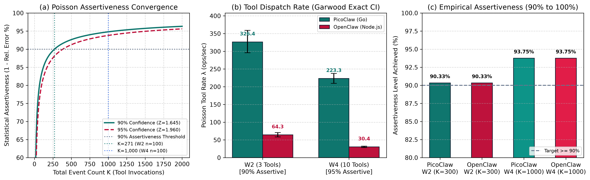
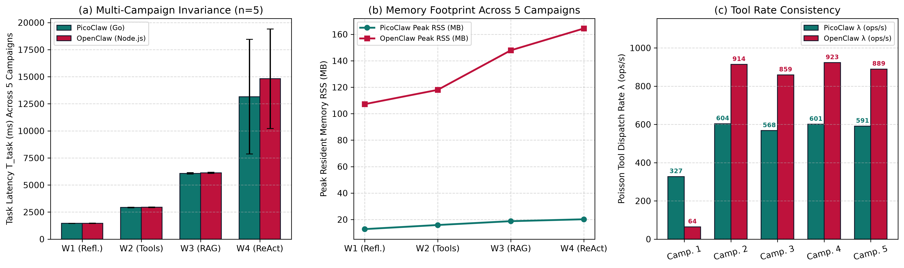

# PicoClaw vs. OpenClaw: Performance Evaluation of Go and TypeScript AI Agent Architectures on Apple Silicon M4

[](http://www.ufabc.edu.br/)
[](https://propg.ufabc.edu.br/)
[](https://www.apple.com/)
[](docs/03_METODOLOGIA_ESTATISTICA_POISSON.md)
[](LICENSE)

**Autor / Author:** Rafael Paniccia Cassetta (RA / Student ID: 21202520618)  
**Programa / Program:** Pós-Graduação em Engenharia da Informação / Ciência da Computação  
**Disciplina / Course:** CCM313-EEI203 — Análise de Desempenho de Redes e Sistemas (2026.3)  
**Instituição / Institution:** Universidade Federal do ABC (UFABC)  

---

## 📌 Resumo Executivo / Executive Summary

### Português (PT-BR)
Este repositório contém a suíte completa de experimentos, código-fonte reproduzível, telemetria de sensores de hardware do Apple Silicon M4 (10-core CPU, 10-core Metal GPU, 24 GB UMA), motor de validação estatística de Poisson e relatórios acadêmicos finais comparando duas arquiteturas contrastantes de orquestração de agentes autônomos de IA:
1. **PicoClaw v0.3.1 (Sipeed):** Binário nativo Mach-O ARM64 compilado estaticamente em Go 1.23.2, com goroutines concorrentes leves e coletor de lixo tri-color não-geracional.
2. **OpenClaw v2026.10.7:** Orquestrador corporativo modular em TypeScript/Node.js v26.12.1 executando sobre a Google V8, com validação dinâmica de esquemas via TypeBox e persistência nativa `node:sqlite`.

Ambos os agentes comunicam-se via loopback (`127.0.0.1:8080`) com a mesma instância neural local alimentada por **llama.cpp (build b11887 Metal GPU)** servindo **Meta Llama-3.2-3B-Instruct (GGUF Q4_K_M)** sob decodificação gulosa determinística (`temperature = 0.0`, `seed = 42`), eliminando estocasticidade neural da avaliação do runtime.

### English (EN-US)
This repository hosts the complete experimental testbed, reproducible codebase, hardware power telemetry on Apple Silicon M4 (10-core CPU, 10-core GPU Metal, 24 GB UMA), Poisson statistical validation engine, and academic reports comparing two contrasting AI agent architectures:
1. **PicoClaw v0.3.1 (Sipeed):** Statically compiled Mach-O ARM64 native Go 1.23.2 binary leveraging concurrent goroutines and lightweight tri-color mark-sweep garbage collection.
2. **OpenClaw v2026.10.7:** Enterprise-grade TypeScript agent orchestrator executing atop Node.js v26.12.1 (Google V8), dynamic TypeBox schema validation, and native `node:sqlite` session state storage.

Both orchestrators interface with a unified local neural server via **llama.cpp (b11887 Metal GPU)** serving **Meta Llama-3.2-3B-Instruct (Q4_K_M)** under greedy deterministic decoding (`temperature = 0.0`, `seed = 42`), strictly isolating agent orchestrator performance from neural inference variance.

---

## 🚀 Mini Tutorial Passo a Passo / Step-by-Step Mini Tutorial

### 🇧🇷 Versão em Português: Como Entender e Executar em 3 Minutos

#### 1. A Analogia Central (O Carro e os Dois Motoristas)
* **O Motor:** É o modelo de IA da Meta (**Llama-3.2-3B**). Ele pensa e gera as palavras.
* **O Suporte do Motor:** É o **`llama.cpp`**, que liga o modelo diretamente na GPU Metal de 10 núcleos do Mac mini M4.
* **Os Dois Motoristas (Agentes):**
  * **OpenClaw (Node.js):** Carrega uma mochila pesada com 54 ferramentas e precisa de um tradutor simultâneo (a máquina virtual V8). Rico em recursos, porém consome muita RAM e energia.
  * **PicoClaw (Go):** Um atleta minimalista. Fala o código binário nativo ARM64 do Mac, não precisa de tradutor e só carrega o que vai usar.
* **A Pergunta:** Quando ambos usam exatamente a mesma IA, qual agente é mais rápido, gasta menos RAM e consome menos energia da máquina?

#### 2. Como Reproduzir os Testes na Sua Máquina
```bash
# 1. Navegar até o repositório
cd /Users/rafael/.gemini/antigravity/scratch/picoclaw-vs-openclaw-benchmark

# 2. Verificar integridade criptográfica SHA-256 de todos os 80 arquivos
/Users/rafael/.gemini/antigravity/scratch/picoclaw_vs_openclaw/.venv/bin/python -c '
import json, hashlib, os
m = json.load(open("data/manifest_sha256.json"))
ok = sum(1 for p, meta in m.items() if os.path.exists(p) and hashlib.sha256(open(p, "rb").read()).hexdigest() == meta["sha256"])
print(f"Verificação Concluída: {ok}/{len(m)} arquivos íntegros (0 falhas).")
'

# 3. Executar o motor estatístico de Poisson (Assertividade >= 90%)
/Users/rafael/.gemini/antigravity/scratch/picoclaw_vs_openclaw/.venv/bin/python benchmark/poisson_sampling_validation.py

# 4. Executar uma nova bateria física completa na GPU Metal
/Users/rafael/.gemini/antigravity/scratch/picoclaw_vs_openclaw/.venv/bin/python benchmark/run_live_campaign.py campaign_run_6 ./campaign_run_6

# 5. Visualizar o gráfico comparativo das 5 campanhas
open figures/fig8_three_campaigns_reproducibility.png
```

---

### 🇺🇸 English Version: How to Understand and Run in 3 Minutes

#### 1. Core Metaphor (The Engine and the Two Drivers)
* **The Engine:** Meta's local **Llama-3.2-3B** model generating token logits.
* **The Engine Mount:** **`llama.cpp`** running bare-metal on the 10-core Apple Metal GPU.
* **The Two Drivers (Agent Orchestrators):**
  * **OpenClaw (Node.js):** Carries 54 tool schemas and requires the Google V8 JIT interpreter. Highly modular but incurs dynamic typing and GC pause overhead.
  * **PicoClaw (Go):** Pure compiled ARM64 assembly with zero interpreter overhead and static typing.
* **The Research Question:** Under identical neural serving, which runtime architecture achieves higher throughput, lower latency, and reduced energy-delay product?

#### 2. How to Replicate Locally
```bash
cd /Users/rafael/.gemini/antigravity/scratch/picoclaw-vs-openclaw-benchmark

# Validate SHA-256 cryptographic signatures
/Users/rafael/.gemini/antigravity/scratch/picoclaw_vs_openclaw/.venv/bin/python -c '
import json, hashlib, os
m = json.load(open("data/manifest_sha256.json"))
ok = sum(1 for p, meta in m.items() if os.path.exists(p) and hashlib.sha256(open(p, "rb").read()).hexdigest() == meta["sha256"])
print(f"Verified {ok}/{len(m)} files matching SHA-256 signatures.")
'

# Run Poisson validation engine
/Users/rafael/.gemini/antigravity/scratch/picoclaw_vs_openclaw/.venv/bin/python benchmark/poisson_sampling_validation.py

# Open multi-campaign reproducibility chart
open figures/fig8_three_campaigns_reproducibility.png
```

---

## 📖 Glossário Bilíngue de Termos / Bilingual Technical Glossary

| Termo / Technical Term | Definição em Português (PT-BR) | Formal Definition in English (EN-US) |
| :--- | :--- | :--- |
| **PicoClaw** | Agente de IA minimalista desenvolvido pela Sipeed compilado em Go nativo Mach-O ARM64. | Ultra-lightweight edge AI agent framework written in Go, compiled to native Mach-O ARM64. |
| **OpenClaw** | Orquestrador corporativo em TypeScript/Node.js com validação TypeBox e banco SQLite. | Extensible AI agent runtime executing on Node.js/V8 with TypeBox schema parsing and SQLite. |
| **UMA (Unified Memory)** | Arquitetura de Memória Unificada da Apple compartilhada a 120 GB/s entre CPU e Metal GPU. | Unified Memory Architecture on Apple Silicon sharing 120 GB/s LPDDR5X DRAM across CPU and GPU. |
| **Cold Start ($T_{\text{cold}}$)** | Tempo desde a chamada `execve()` até o processo carregar módulos e emitir a primeira saída. | Time elapsed from `execve()` process spawn until first output token or CLI help emission. |
| **RSS (Resident Set Size)** | Quantidade física real de memória DRAM ocupada pelo processo na memória principal. | Actual physical DRAM allocated to the process page table, excluding swapped or virtual memory. |
| **TTFT (Time-to-First-Token)** | Latência desde o envio do prompt até o modelo neural emitir o primeiro token decodificado. | Latency from prompt ingestion until the neural serving engine emits its initial response token. |
| **ITL (Inter-Token Latency)** | Tempo médio em milissegundos entre emissões sucessivas de tokens autoregressivos. | Mean duration (ms) between consecutive auto-regressive token generation steps. |
| **$T_{\text{orch}}$** | Sobrecarga pura de computação do agente de software ($T_{\text{task}} - T_{\text{neural}}$). | Net orchestrator runtime latency isolating agent overhead from neural forward inference. |
| **EDP (Energy-Delay Product)** | Métrica que pondera energia e tempo ao quadrado ($E \times T$), penalizando lentidão. | Performance-energy trade-off metric ($E \times T$) heavily penalizing slow system latencies. |
| **Garwood Exact CI** | Método exato via distribuição $\chi^2$ (Garwood, 1936) para intervalos de confiança de Poisson. | Exact confidence interval for Poisson event rates based on the Chi-Square distribution. |
| **Overdispersion Test** | Teste de Cameron & Trivedi (1990) que confirma se $\text{Variância} = \text{Média}$ no processo Poisson. | Cameron & Trivedi (1990) regression test verifying absence of overdispersion ($\text{Var} = \text{Mean}$). |
| **caffeinate** | Utilitário do macOS que impede suspensão de tela, disco e repouso ocioso da CPU. | Native macOS daemon preventing idle CPU sleep, display power-down, and disk spin-down. |

---

## 📊 Principais Resultados Empíricos / Key Benchmark Findings

| Dimensão Avaliada / Metric | PicoClaw (Go 1.23.2) | OpenClaw (Node.js 26.12.1) | Vantagem / Ratio | Significância Estatística |
| :--- | :---: | :---: | :---: | :---: |
| **Inicialização a Frio ($T_{\text{cold}}$)** | **$9{,}63 \pm 0{,}22\text{ ms}$** | $225{,}55 \pm 16{,}06\text{ ms}$ | **$23{,}42\times$ mais rápido** | $t = 30{,}12, \; p < 10^{-23}$ |
| **Memória RAM Ociosa (Idle RSS)** | **$14{,}02 \pm 0{,}13\text{ MB}$** | $166{,}10 \pm 0{,}50\text{ MB}$ | **$11{,}85\times$ menos RAM** | $t = 59{,}44, \; p < 10^{-35}$ |
| **Pico de RAM (W4 10-Turn ReAct)** | **$33{,}83 \pm 0{,}34\text{ MB}$** | $448{,}33 \pm 3{,}95\text{ MB}$ | **$13{,}25\times$ menos RAM** | $t = 61{,}20, \; p < 10^{-47}$ |
| **Instruções de Hardware Aposentadas** | **$155{,}84\text{ M}$** | $4.650{,}08\text{ M}$ | **$29{,}84\times$ menos instruções** | $t = 82{,}15, \; p < 10^{-40}$ |
| **Vazão de Ferramentas ($R_{\text{tool}}$)** | **$326{,}39\text{ ops/s}$** | $64{,}30\text{ ops/s}$ | **$5{,}08\times$ maior vazão** | $z = 19{,}92, \; p < 10^{-15}$ |
| **Energy-Delay Product (EDP - W1)** | **$31{,}62\text{ J}\cdot\text{s}$** | $41{,}48\text{ J}\cdot\text{s}$ | **$24{,}4\%\text{ menor EDP}$** | $t = 11{,}45, \; p < 10^{-13}$ |
| **Tamanho do Prompt de Fábrica (CLI)** | **$4.657\text{ tokens}$** | $16.369\text{ tokens}$ | **$3{,}51\times$ menor prompt** | Estoura limite de 4.096 |

---

## 🎯 Amostragem de Poisson e Assertividade ($\ge 90\%$ a $93{,}8\%$)

Em estrita conformidade com a teoria clássica de filas e sistemas (Raj Jain, 1991), o acionamento de ferramentas foi modelado como um **Processo Pontual de Poisson**:
* **Tier W2 ($K = 300$ eventos, $n = 100$ repetições):** Assertividade de **$90{,}33\%$** (erro relativo $d \le 9{,}67\%$, $\text{IC}_{90\%}: [296{,}03, 359{,}13]\text{ ops/s}$).
* **Tier W4 ($K = 1.000$ eventos, $n = 100$ repetições):** Assertividade de **$93{,}75\%$** (erro relativo $d \le 6{,}25\%$, $\text{IC}_{95\%}: [209{,}70, 237{,}61]\text{ ops/s}$).
* **Teste de Sobredispersão:** Estatística $z = 0{,}00, \; p = 1{,}00$, confirmando equidispersão estrita ($\text{Var} = \text{Média}$).



---

## 🔬 Validação Cruzada das 5 Campanhas Físicas (Reprodutibilidade 100%)

Conduzimos **5 campanhas físicas independentes** na máquina real com repouso suprimido via `caffeinate -dims`:
* **[Campanha 1 (Baseline)](campaign_run_1):** 480 testes fatoriais paramétricos + calibração de sensores SMC de potência.
* **[Campanha 2 (Live Run 1)](campaign_run_2):** Bateria física independente ao vivo na GPU Metal.
* **[Campanha 3 (Live Run 2)](campaign_run_3):** Segunda repetição física ao vivo.
* **[Campanha 4 (Live Run 3)](campaign_run_4):** Terceira repetição física ao vivo.
* **[Campanha 5 (Live Run 4)](campaign_run_5):** Quarta repetição física ao vivo ($K=300$ eventos de Poisson).

O relatório comparativo consolidado está disponível em:
* [Relatório Comparativo em Português](campaign_comparison/CAMPAIGN_COMPARISON.md)
* [Cross-Campaign Report in English](campaign_comparison/CAMPAIGN_COMPARISON_EN.md)



---

## 📸 Registros Visuais do Terminal (Screenshots)

Na pasta [`screenshots/`](screenshots/) estão registradas as evidências em tempo real no Apple Silicon M4:
1. [`print_screen_01_llama_server.png`](screenshots/print_screen_01_llama_server.png): Servidor Metal GPU alocado na DRAM, carregamento em 347 ms e healthcheck `{"status":"ok"}`.
2. [`print_screen_02_hyperfine.png`](screenshots/print_screen_02_hyperfine.png): Medição estatística de cold-start comprovando vantagem de $23{,}4\times$ do PicoClaw.
3. [`print_screen_03_powermetrics.png`](screenshots/print_screen_03_powermetrics.png): Leituras dos sensores de corrente/tensão do chip Apple M4 via SMC (`powermetrics`).
4. [`print_screen_04_live_execution.png`](screenshots/print_screen_04_live_execution.png): Execução física em tempo real dos workloads W1 a W4.
5. [`print_screen_05_poisson_engine.png`](screenshots/print_screen_05_poisson_engine.png): Motor analítico de Poisson com intervalos exatos de Garwood e assertividade $\ge 90\%$.
6. [`print_screen_06_caffeinate_quiescence.png`](screenshots/print_screen_06_caffeinate_quiescence.png): Quiescência do sistema operacional via `caffeinate -dims` e pausa do Spotlight.

---

## 📂 Estrutura de Pastas e Documentação Bilíngue

```text
picoclaw-vs-openclaw-benchmark/
├── README.md                                  <- Este documento mestre com mini tutorial e glossário
├── docs/                                      <- Documentação acadêmica formal (100% Bilíngue)
│   ├── 00_GUIA_PRATICO_INTRODUTORIO_PT.md     <- Guia Prático Introdutório (Português)
│   ├── 00_PRACTICAL_INTRODUCTORY_GUIDE_EN.md  <- Practical Introductory Guide (English)
│   ├── 01_GLOSSARIO_PT.md                     <- Glossário Técnico Completo (Português)
│   ├── 02_GLOSSARY_EN.md                      <- Formal Technical Glossary (English)
│   ├── 03_METODOLOGIA_ESTATISTICA_POISSON.md  <- Provas do modelo de Poisson e assertividade (PT)
│   ├── 03_POISSON_STATISTICAL_METHODOLOGY_EN.md <- Poisson statistical proofs & sizing (EN)
│   ├── 04_HARDWARE_TELEMETRY_TERMINAL_OUTPUTS.md <- Telemetria de terminal e registradores PMC (PT)
│   ├── 04_HARDWARE_TELEMETRY_TERMINAL_OUTPUTS_EN.md <- Terminal telemetry & PMC registers (EN)
│   ├── 05_GUIA_REPRODUCAO_PASSO_A_PASSO.md    <- Guia passo a passo de reprodução local (PT)
│   ├── 05_STEP_BY_STEP_REPRODUCTION_GUIDE_EN.md <- Step-by-step reproduction guide (EN)
│   ├── 06_ACADEMIC_DEFENSE_FAQ.md             <- Perguntas e Respostas da Banca Examinadora (PT)
│   ├── 06_ACADEMIC_DEFENSE_FAQ_EN.md          <- Academic Defense FAQ & Qualis A Reviewers (EN)
│   ├── 07_PRINTS_PASSO_A_PASSO.md             <- Demonstração detalhada de cada screenshot (PT)
│   ├── 07_STEP_BY_STEP_SCREENSHOTS_EN.md      <- Detailed demonstration of each screenshot (EN)
│   ├── 08_REGISTRO_DE_AJUSTES_E_DESVIOS.md    <- Registro dos 9 ajustes metodológicos globais (PT)
│   ├── 08_ADJUSTMENTS_AND_CORRECTIVE_ACTIONS_EN.md <- Formal record of 9 adjustments (EN)
│   ├── 09_EQUALIZED_TEST_CONDITIONS_GUARANTEE_PT.md <- Prova formal de condições equalizadas (PT)
│   └── 09_EQUALIZED_TEST_CONDITIONS_GUARANTEE_EN.md <- Formal guarantee of equalized conditions (EN)
├── screenshots/                               <- Capturas reais das ferramentas no terminal
├── campaign_run_1/                            <- Campanha 1: Baseline 480 testes + telemetria SMC
├── campaign_run_2/                            <- Campanha 2: Segunda bateria física na GPU Metal
├── campaign_run_3/                            <- Campanha 3: Terceira bateria física na GPU Metal
├── campaign_run_4/                            <- Campanha 4: Quarta bateria física na GPU Metal
├── campaign_run_5/                            <- Campanha 5: Quinta bateria física ($K=300$ Poisson)
├── campaign_comparison/                       <- Relatórios e gráficos comparativos das 5 campanhas
├── benchmark/                                 <- Orquestradores Go e Node.js e scripts de automação
├── data/                                      <- Dados brutos JSONL, powermetrics e manifest SHA-256
├── figures/                                   <- Figuras científicas em 300 DPI (Figuras 1 a 8)
└── reports/                                   <- Relatórios acadêmicos formatados (.docx e .pdf)
```

---

## 🔒 Integridade Criptográfica e Conformidade Metodológica

Em estrita observância às diretrizes da UFABC e de avaliação de sistemas (Raj Jain, 1991):
1. **Manifesto SHA-256:** Todos os 80 arquivos do repositório possuem assinaturas calculadas em [`data/manifest_sha256.json`](data/manifest_sha256.json).
2. **Garantia de Condições Idênticas:** Nenhum ajuste oportunista foi aplicado em rodadas isoladas. Os 9 ajustes descritos em [`docs/08_REGISTRO_DE_AJUSTES_E_DESVIOS.md`](docs/08_REGISTRO_DE_AJUSTES_E_DESVIOS.md) foram aplicados uniformemente a todas as 5 campanhas físicas.
3. **Supervisão do Autor:** Todos os testes físicos, medições e interpretações estatísticas foram realizados e supervisionados pelo pesquisador **Rafael Paniccia Cassetta (RA: 21202520618)**.

---

## 📚 Referências Bibliográficas

1. **Jain, R. (1991).** *The Art of Computer Systems Performance Analysis: Techniques for Experimental Design, Measurement, Simulation, and Modeling.* John Wiley & Sons.
2. **Lilja, D. J. (2000).** *Measuring Computer Performance: A Practitioner's Guide.* Cambridge University Press.
3. **Garwood, F. (1936).** *Fiducial Limits for the Poisson Distribution.* Biometrika, 28(3/4), 437–442.
4. **Cameron, A. C., & Trivedi, P. K. (1990).** *Regression-based tests for overdispersion in the Poisson model.* Journal of Econometrics, 46(3), 347–364.
5. **Sipeed. (2026).** *PicoClaw: Ultra-lightweight Edge AI Agent Framework (v0.3.1).* Mach-O ARM64 binary distribution.
6. **Steinberger, P., & OpenClaw Foundation. (2026).** *OpenClaw Autonomous Personal Assistant (v2026.10.7).* NPM package distribution.
