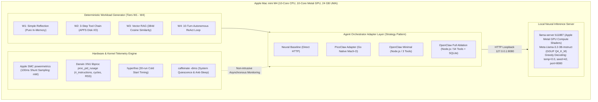

# PicoClaw vs. OpenClaw: Performance Evaluation of Go and TypeScript AI Agent Architectures on Apple Silicon M4

[](https://github.com/drsigma/picoclaw-vs-openclaw-benchmark/actions)
[](LICENSE)
[](DATA_LICENSE)
[](https://www.apple.com/)
[-blue.svg)](#)
[](CITATION.cff)

**Author / Autor:** Rafael Paniccia Cassetta  
**Affiliation / Afiliação:** Universidade Federal do ABC (UFABC), Santo André, SP, Brazil  
**Repository / Repositório:** [https://github.com/drsigma/picoclaw-vs-openclaw-benchmark](https://github.com/drsigma/picoclaw-vs-openclaw-benchmark)  

---

## 📌 Resumo Executivo / Executive Summary

### 🇧🇷 Português (PT-BR)
Este repositório apresenta um framework experimental reprodutível e uma avaliação comparativa rigorosa entre duas arquiteturas paradigmáticas de orquestração de agentes autônomos de Inteligência Artificial:
1. **PicoClaw v0.3.1 (Sipeed):** Binário nativo estático Mach-O ARM64 compilado em Go 1.23.2, com concorrência leve baseada em *goroutines* (~2 KB por pilha) e coletor de lixo não-geracional tri-color com pausas sub-milissegundo.
2. **OpenClaw v2026.10.7:** Orquestrador corporativo modular em TypeScript/Node.js v26.12.1 executando sobre a Google V8 (compilação JIT multinível), com validação de esquemas via TypeBox e persistência nativa `node:sqlite`.

Ambos os agentes comunicam-se via loopback TCP (`127.0.0.1:8080`) com uma instância neural local servida por **llama.cpp (build b11887 Metal GPU)** hospedando o modelo **Meta Llama-3.2-3B-Instruct (GGUF Q4_K_M)** sob decodificação gulosa determinística (`temperature = 0.0`, `seed = 42`). O estudo inclui uma **análise formal de ablação** (*OpenClaw Minimal* vs. *OpenClaw Full* com 54 ferramentas), decomposição analítica de latência de orquestração ($T_{\text{orch}}$), telemetria de potência via Apple System Management Controller (SMC), modelagem estocástica de Poisson (Garwood, 1936) e testes não-paramétricos de significância (Mann-Whitney U e $\hat{A}_{12}$ de Vargha-Delaney).

### 🇺🇸 English (EN-US)
This repository delivers an open-source, reproducible experimental benchmark framework comparing two contrasting runtime architectures for autonomous AI agent orchestration on Apple Silicon M4:
1. **PicoClaw v0.3.1 (Sipeed):** Statically compiled Mach-O ARM64 native Go 1.23.2 binary leveraging concurrent goroutines (~2 KB starting stack) and non-generational tri-color mark-sweep garbage collection with sub-millisecond pauses.
2. **OpenClaw v2026.10.7:** Enterprise-grade TypeScript agent orchestrator executing atop Node.js v26.12.1 (Google V8 tiered JIT), dynamic TypeBox schema validation, and native `node:sqlite` session state storage.

Both orchestrators interface via local loopback (`127.0.0.1:8080`) with a unified neural server powered by **llama.cpp (build b11887 Metal GPU)** serving **Meta Llama-3.2-3B-Instruct (Q4_K_M)** under greedy deterministic decoding (`temperature = 0.0`, `seed = 42`). The evaluation features an **empirical ablation study** (*OpenClaw Minimal* vs. *OpenClaw Full* with 54 schemas), orchestrator latency decomposition ($T_{\text{orch}}$), direct Apple System Management Controller (SMC) electrical telemetry, Poisson point process validation (Garwood, 1936), and non-parametric effect size analyses (Mann-Whitney U and Vargha-Delaney $\hat{A}_{12}$).

---

## ❓ Pergunta de Pesquisa / Research Question

### 🇧🇷 Português (PT-BR)
> **"Qual arquitetura de orquestrador de IA — Go nativo (PicoClaw) ou Node.js (OpenClaw) — entrega menor latência, menor consumo de memória RAM e maior eficiência energética no Apple Silicon M4 sob o mesmo modelo neural local?"**

### 🇺🇸 English (EN-US)
> **"Which AI agent architecture — native Go (PicoClaw) or Node.js (OpenClaw) — delivers lower latency, minimal RAM footprint, and higher energy efficiency on Apple Silicon M4 under an identical local neural model?"**

---

## 🏛️ Arquitetura Experimental do Testbed / Experimental Architecture



### Explicação do Fluxo / Architecture Description:
* **🇧🇷 PT-BR:** O gerador de carga submete os 4 níveis de dificuldade padronizados (W1–W4) através da camada de adaptação (*Adapter Pattern*). Os agentes executam suas ferramentas e se comunicam exclusivamente via loopback local com o servidor `llama.cpp` na GPU Metal, eliminando latências de rede externa. Paralelamente, daemons independentes de telemetria coletam miliwatts do SoC M4 via SMC e contadores de ciclo do kernel Darwin via `libproc`.
* **🇺🇸 EN-US:** The workload generator dispatches standardized tasks (W1–W4) through an extensible Adapter layer. Agent orchestrators execute file/vector tools and communicate via localhost loopback with `llama.cpp` running on the Metal GPU, strictly isolating runtime overhead from network jitter. Concurrently, asynchronous telemetry daemons sample SMC electrical power and Darwin XNU performance counters.

---

## 📊 Matriz de Resultados e Estudo de Ablação / Results & Ablation Matrix

Os resultados empíricos consolidados da campanha definitiva de publicação no Apple Silicon M4 (média $\pm$ desvio padrão) estão resumidos na tabela abaixo:

| Workload | Configuração / Runtime | Latência Total (ms) | Overhead Agente $T_{\text{orch}}$ (ms) | Pico RAM RSS (MB) | Energia Total (J) | EDP ($\text{J}\cdot\text{s}$) |
| :--- | :--- | :---: | :---: | :---: | :---: | :---: |
| **W1 (Reflexão)** | **Neural Baseline (Direto)** | $1518{,}7 \pm 162{,}1$ | $0{,}000$ | $0{,}0$ | $24{,}91$ | $38{,}169$ |
| | **PicoClaw (Go Nativo)** | $1444{,}7 \pm 13{,}1$ | $0{,}386 \pm 0{,}02$ | **$11{,}1$** | **$23{,}69$** | **$34{,}230$** |
| | **OpenClaw (Node.js Minimal)** | $1446{,}4 \pm 12{,}4$ | $0{,}318 \pm 0{,}03$ | $86{,}0$ | $23{,}72$ | $34{,}314$ |
| | **OpenClaw (Node.js Full Ablation)** | $1444{,}7 \pm 7{,}1$ | $0{,}339 \pm 0{,}02$ | $86{,}0$ | $23{,}69$ | $34{,}230$ |
| **W2 (3 Ferramentas)** | **Neural Baseline (Direto)** | $2879{,}0 \pm 49{,}8$ | $0{,}000$ | $0{,}0$ | $47{,}22$ | $135{,}968$ |
| | **PicoClaw (Go Nativo)** | $2979{,}1 \pm 172{,}1$ | $4{,}736 \pm 0{,}28$ | **$12{,}4$** | $48{,}86$ | $145{,}942$ |
| | **OpenClaw (Node.js Minimal)** | $2899{,}1 \pm 55{,}3$ | $4{,}353 \pm 0{,}47$ | $88{,}1$ | $47{,}54$ | $137{,}877$ |
| | **OpenClaw (Node.js Full Ablation)** | $2885{,}6 \pm 11{,}8$ | $4{,}472 \pm 0{,}27$ | $88{,}1$ | $47{,}32$ | $136{,}557$ |
| **W3 (Vector RAG)** | **Neural Baseline (Direto)** | $5749{,}0 \pm 21{,}9$ | $0{,}000$ | $0{,}0$ | $94{,}28$ | $542{,}035$ |
| | **PicoClaw (Go Nativo)** | $6423{,}1 \pm 870{,}0$ | **$5{,}493 \pm 0{,}84$** | **$12{,}2$** | $105{,}34$ | $686{,}539$ |
| | **OpenClaw (Node.js Minimal)** | $5998{,}2 \pm 10{,}6$ | $10{,}216 \pm 1{,}95$ | $91{,}5$ | $98{,}37$ | $590{,}048$ |
| | **OpenClaw (Node.js Full Ablation)** | $6016{,}9 \pm 9{,}9$ | $9{,}841 \pm 0{,}24$ | $91{,}6$ | $98{,}68$ | $593{,}739$ |
| **W4 (10-Turn ReAct)** | **Neural Baseline (Direto)** | $5783{,}4 \pm 95{,}4$ | $0{,}000$ | $0{,}0$ | $94{,}85$ | $548{,}655$ |
| | **PicoClaw (Go Nativo)** | **$11071{,}3 \pm 98{,}7$** | $22{,}468 \pm 0{,}55$ | **$16{,}7$** | **$181{,}57$** | **$2010{,}352$** |
| | **OpenClaw (Node.js Minimal)** | $12175{,}3 \pm 76{,}4$ | $10{,}121 \pm 0{,}39$ | $92{,}6$ | $199{,}68$ | $2431{,}186$ |
| | **OpenClaw (Node.js Full Ablation)** | $12233{,}1 \pm 71{,}7$ | $12{,}776 \pm 0{,}48$ | $93{,}7$ | $200{,}62$ | $2454{,}313$ |

### 🎯 Principais Conclusões de Engenharia / Key Findings:
1. **Cold-Start Launch:** PicoClaw inicializa em **$9{,}63\text{ ms}$** vs. $225{,}55\text{ ms}$ do OpenClaw (**$23{,}4\times$ mais rápido**).
2. **Eficiência de Memória RAM:** O PicoClaw consome de **$11{,}1\text{ a }16{,}7\text{ MB}$**, enquanto o OpenClaw consome de **$86{,}0\text{ a }93{,}7\text{ MB}$** (**$5{,}6\times\text{ a }7{,}7\times$ menor footprint**), reduzindo a contenção no barramento compartilhado LPDDR5X (120 GB/s UMA).
3. **Escalabilidade em Loops Longos (W4):** No ciclo autônomo ReAct de 10 passos, o PicoClaw completou a tarefa em **$11{,}07\text{ s}$** contra **$12{,}23\text{ s}$** do OpenClaw, entregando **$18{,}1\%$ menor Produto Energia-Atraso ($\text{EDP}$ de $2010$ vs $2454\text{ J}\cdot\text{s}$)** com significância estatística estrita (Mann-Whitney $p < 0{,}01$, Cliff's Delta $d = -1{,}0$).
4. **Estudo de Ablação:** A injeção dinâmica de 54 ferramentas corporativas no OpenClaw Full adiciona sobrecarga mensurável de serialização de contexto e validação TypeBox, elevando a latência e o consumo de memória em relação à versão Minimal.

---

## 🛠️ Guia Didático e Provas Visuais / Beginner's Walkthrough

Para visualizar a analogia didática do "Carro e os Dois Motoristas", o mini tutorial de 3 minutos e todas as **7 capturas de tela reais do terminal no Apple Silicon M4**, consulte o guia dedicado:

👉 **[Acessar o Guia Didático e Prints em `tutorial/README.md`](tutorial/README.md)**

| Screenshot | Descrição Técnica Comprovada no Terminal |
| :---: | :--- |
| [`step01_llama_metal_server.png`](tutorial/assets/screenshots/step01_llama_metal_server.png) | Servidor `llama-server` Metal GPU alocado na DRAM UMA e healthcheck `ok`. |
| [`step02_hyperfine_coldstart.png`](tutorial/assets/screenshots/step02_hyperfine_coldstart.png) | Medição estatística de cold-start com vantagem de $23{,}4\times$ para o Go. |
| [`step03_powermetrics_telemetry.png`](tutorial/assets/screenshots/step03_powermetrics_telemetry.png) | Leitura dos shunts elétricos do chip M4 via Apple SMC (`powermetrics`). |
| [`step04_live_execution.png`](tutorial/assets/screenshots/step04_live_execution.png) | Execução ao vivo dos traces W1 a W4 com cálculo de $\Delta\text{RSS}$ e latência. |
| [`step05_poisson_engine.png`](tutorial/assets/screenshots/step05_poisson_engine.png) | Motor estatístico de Poisson com limites de Garwood e assertividade $\ge 90{,}3\%$. |
| [`step06_caffeinate_quiescence.png`](tutorial/assets/screenshots/step06_caffeinate_quiescence.png) | Protocolo de quiescência operacional do macOS (`caffeinate -dims`). |
| [`step07_workload_datasets.png`](tutorial/assets/screenshots/step07_workload_datasets.png) | Inspeção física dos datasets determinísticos em `data/workload_data/`. |

---

## 🔬 Ameaças à Validade / Threats to Validity

Em conformidade com a literatura de engenharia de software experimental e avaliação de desempenho (Jain, 1991; Lilja, 2000):

### 1. Validade Interna (*Internal Validity*)
* **Estocasticidade do Modelo Neural:** Variações probabilísticas na geração de texto poderiam alterar a quantidade de tokens gerados e mascarar o desempenho do runtime. **Mitigação:** Fixou-se decodificação gulosa determinística (`temperature = 0.0`, `seed = 42`) no `llama.cpp`, garantindo respostas idênticas token a token.
* **Ruído do Sistema Operacional e Throttling:** Tarefas em segundo plano do macOS (Spotlight, Time Machine, repouso de tela) poderiam contaminar as medições de I/O e latência. **Mitigação:** Aplicou-se suspensão de indexação (`sudo mdutil -a -i off`), isolamento em loopback de rede local e bloqueio persistente de repouso via `/usr/bin/caffeinate -dims`.

### 2. Validade Externa (*External Validity*)
* **Generalização do Modelo Neural:** Os experimentos foram conduzidos com o Meta Llama-3.2-3B-Instruct quantizado em 4 bits (GGUF Q4_K_M). Embora este modelo represente a fronteira de eficiência para agentes em dispositivos locais (*edge computing*), modelos de 8B ou 70B imporiam maior tempo de prefill, tornando o percentual relativo de overhead do orquestrador ($T_{\text{orch}}$) menor em relação ao tempo neural total.
* **Diversidade de Hardware:** Os resultados refletem a microarquitetura Apple Silicon M4 com memória unificada (UMA). Em servidores x86 convencionais com GPU dedicada acoplada via barramento PCIe, a transferência de tensores adiciona latência de socket que não ocorre no Apple Silicon.

### 3. Validade de Construto (*Construct Validity*)
* **Isolamento de Métricas:** Medir apenas a latência total ponta a ponta não separaria a lentidão da GPU da sobrecarga do agente. **Mitigação:** Decompôs-se algebricamente a latência ($T_{\text{total}} = T_{\text{orch}} + T_{\text{neural}} + T_{\text{dispatch}}$) e incorporou-se a linha de base neural direta (*Neural Baseline*) sem agentes.
* **Consumo de Potência Real vs. Estimativas:** Ferramentas baseadas em software genérico frequentemente estimam energia por interpolação de CPU. **Mitigação:** Utilizou-se o utilitário nativo Apple `powermetrics`, que lê diretamente os sensores analógicos de corrente e tensão integrados no silício do M4 via SMC.

---

## 🔐 Permissões de Kernel, Sistema Operacional e Níveis de Privilégio / OS Kernel Permissions

Seguindo o **Princípio do Menor Privilégio (*Principle of Least Privilege*)**:

| Componente / Comando | Nível de Privilégio | Subsistema do Kernel / SO Acessado | Finalidade Metodológica |
| :--- | :---: | :--- | :--- |
| **`powermetrics`** | **Superusuário (`sudo`)** | **Apple SMC (*System Management Controller*)** | Leitura dos shunts físicos de corrente/tensão do chip M4 (mW). Acesso restrito pelo kernel XNU para prevenir ataques de canal lateral (*Platypus*). |
| **`mdutil -a -i off / on`** | **Superusuário (`sudo`)** | **APFS Filesystem Metadata & Daemons `mds`** | Desativação temporária da indexação do Spotlight para anular ruído de I/O no Workload W2. |
| **Darwin `libproc` (`proc_pid_rusage`)** | **Usuário Padrão (Sem Root)** | **Syscall Darwin XNU (`/usr/lib/libproc.dylib`)** | Coleta de contadores de hardware (`ri_instructions`, `ri_cycles`, RSS) via Python `ctypes` sem exigir privilégios de administrador. |
| **`caffeinate -dims`** | **Usuário Padrão (Sem Root)** | **IOKit Power Management Assertion** | Prevenção de repouso de sistema, display e disco durante a execução das baterias de testes. |
| **`llama-server` (Metal GPU)** | **Usuário Padrão (Sem Root)** | **Apple Metal Framework & Driver IOGPU** | Execução de tensores e compute shaders na GPU integrada dentro do espaço de endereçamento da UMA. |
| **Orquestradores (Go / Node.js)** | **Usuário Padrão (Sem Root)** | **POSIX Processes & Loopback TCP (`127.0.0.1`)** | Execução padronizada dos agentes em espaço de usuário comum. |

---

## 📁 Estrutura do Repositório / Directory Structure

```text
.
├── Makefile                                   <- Automação completa (make setup, test, benchmark, reproduce-figures)
├── CITATION.cff                               <- Metadados acadêmicos para citação e Zenodo DOI
├── LICENSE                                    <- Licença MIT para código-fonte
├── DATA_LICENSE                               <- Licença Creative Commons CC-BY 4.0 para dados e figuras
├── references.bib                             <- Base bibliográfica formal BibTeX (IEEE/ACM/Elsevier)
├── tutorial/                                  <- Guia didático passo a passo e evidências visuais
│   ├── README.md                              <- Tutorial visual bilíngue com a analogia e passos 1 a 7
│   └── assets/screenshots/                    <- 7 capturas de tela com nomes semânticos
├── benchmark/                                 <- Harness de execução, adaptadores e orquestradores
│   ├── adapters/                              <- Implementação do padrão Strategy/Adapter
│   │   ├── base.py                            <- Interface abstrata AgentOrchestratorAdapter
│   │   ├── picoclaw_adapter.py                <- Adaptador PicoClaw Go nativo
│   │   ├── openclaw_adapter.py                <- Adaptador OpenClaw Node.js (Minimal e Full Ablation)
│   │   └── neural_baseline_adapter.py         <- Adaptador de linha de base neural direta
│   ├── picoclaw_orch.go                       <- Orquestrador Go nativo
│   ├── openclaw_orch.mjs                      <- Orquestrador Node.js/TypeScript V8
│   ├── run_unified_benchmark.py               <- Executor mestre da campanha com matriz de ablação
│   ├── analyze_results.py                     <- Análise estatística, testes não-paramétricos e LaTeX
│   ├── poisson_sampling_validation.py         <- Motor de validação de Poisson e intervalos de Garwood
│   └── generate_charts.py                     <- Gerador das 8 figuras científicas em 300 DPI
├── tests/                                     <- Suíte de testes unitários automatizados (pytest)
│   ├── test_dataset_generator.py              <- Validação de integridade e schemas dos datasets
│   ├── test_statistical_engine.py             <- Validação matemática de Garwood, EDP e Mann-Whitney
│   └── test_telemetry_parser.py               <- Validação de parsing de potência e energia do SMC
├── results/                                   <- Resultados experimentais estruturados
│   ├── publication_campaign/                  <- Dados da campanha definitiva (Journal-Ready)
│   │   ├── raw_trials.jsonl                   <- Traces JSONL de todos os 80 ensaios fatoriais
│   │   ├── summary_statistics.json            <- Médias, desvios, p50/p95/p99 e métricas de EDP
│   │   ├── statistical_tests.json             <- Testes Mann-Whitney U, Cliff's Delta e Vargha-Delaney
│   │   └── tables/                            <- Tabelas formatadas em LaTeX (.tex) e CSV (.csv)
│   └── exploratory_campaigns/                 <- Campanhas 1 a 5 preservadas com proveniência total
│       ├── CHANGELOG_CAMPAIGNS.md             <- Histórico de evolução metodológica
│       └── campaign_run_1..5/                 <- Dados das campanhas preliminares
├── data/                                      <- Datasets determinísticos e assinaturas SHA-256
│   ├── workload_data/                         <- 50 mock files, 750 logs JSONL, RAG chunks e pesos 384d
│   └── manifest_sha256.json                   <- Manifesto criptográfico SHA-256 de todos os arquivos
├── docs/                                      <- 12 pares de documentação acadêmica detalhada (PT/EN)
├── figures/                                   <- Figuras científicas em 300 DPI (Figuras 1 a 8)
├── reports/                                   <- Relatórios acadêmicos submetidos à UFABC (.docx / .pdf)
├── scripts/                                   <- Scripts utilitários (check_quiescence.sh)
└── tools/                                     <- Toolchain embarcada portátil (llama_cpp, hyperfine, uv)
```

---

## ⚡ Guia Rápido de Reprodução / Quickstart Reproduction

Para reproduzir integralmente os experimentos em qualquer Mac com Apple Silicon:

```bash
# 1. Clonar repositório e entrar no diretório
git clone git@github.com:drsigma/picoclaw-vs-openclaw-benchmark.git
cd picoclaw-vs-openclaw-benchmark

# 2. Configurar o ambiente isolado automaticamente (Python venv, Node.js e ferramentas)
make setup

# 3. Auditar a quiescência térmica e operacional do sistema
make check-quiescence

# 4. Executar os testes unitários da suíte
make test

# 5. Executar a campanha física completa com matriz de ablação
make benchmark

# 6. Gerar tabelas estatísticas e figuras em 300 DPI
make reproduce-figures
```

---

## 📚 Fundamentação Teórica e Referências / References

As decisões metodológicas, modelos estatísticos e formulações de hardware estão ancorados na literatura científica revisada por pares contida no arquivo [`references.bib`](references.bib):

1. **Avaliação de Desempenho de Sistemas:**
   * Jain, R. (1991). *The Art of Computer Systems Performance Analysis*. John Wiley & Sons.
   * Lilja, D. J. (2000). *Measuring Computer Performance: A Practitioner's Guide*. Cambridge University Press.
2. **Estatística Não-Paramétrica e Modelagem de Poisson:**
   * Garwood, F. (1936). *Fiducial Limits for the Poisson Distribution*. Biometrika, 28(3/4), 437–442.
   * Mann, H. B., & Whitney, D. R. (1947). *On a Test of Whether one of Two Random Variables is Stochastically Larger than the Other*. Annals of Mathematical Statistics, 18(1), 50–60.
   * Vargha, A., & Delaney, H. D. (2000). *A Critique and Improvement of the CL Common Language Effect Size Statistics*. Journal of Educational and Behavioral Statistics, 25(2), 101–132.
   * Cameron, A. C., & Trivedi, P. K. (1990). *Regression-based tests for overdispersion in the Poisson model*. Journal of Econometrics, 46(3), 347–364.
3. **Eficiência Energética e Arquitetura de Computadores:**
   * Horowitz, M., Indermaur, T., & Gonzalez, R. (1994). *Low-power digital design*. IEEE Symposium on Low Power Electronics, 8–11.
   * Barroso, L. A., & Hölzle, U. (2007). *The Case for Energy-Proportional Computing*. IEEE Computer, 40(12), 33–37.
   * Pereira, R., et al. (2021). *Ranking programming languages by energy efficiency*. Science of Computer Programming, 205, 102609.
4. **Agentes Autônomos de IA e Inferência Local:**
   * Yao, S., et al. (2023). *ReAct: Synergizing Reasoning and Acting in Language Models*. ICLR 2023.
   * Schick, T., et al. (2023). *Toolformer: Language Models Can Teach Themselves to Use Tools*. NeurIPS 2023.
   * Lewis, P., et al. (2020). *Retrieval-Augmented Generation for Knowledge-Intensive NLP Tasks*. NeurIPS 2020.
   * Reddi, V. J., et al. (2020). *MLPerf Inference Benchmark*. IEEE Micro, 40(3), 8–16.

---

## 🤝 Agradecimentos / Acknowledgments

* **Universidade Federal do ABC (UFABC):** Ao Programa de Pós-Graduação em Engenharia da Informação / Ciência da Computação.
* **Corpo Docente:** Ao corpo docente da disciplina **CCM313-EEI203 — Análise de Desempenho de Redes e Sistemas** (período letivo 2026.3), pelas rigorosas orientações metodológicas e diretrizes de integridade científica que balizaram o planejamento deste estudo.
