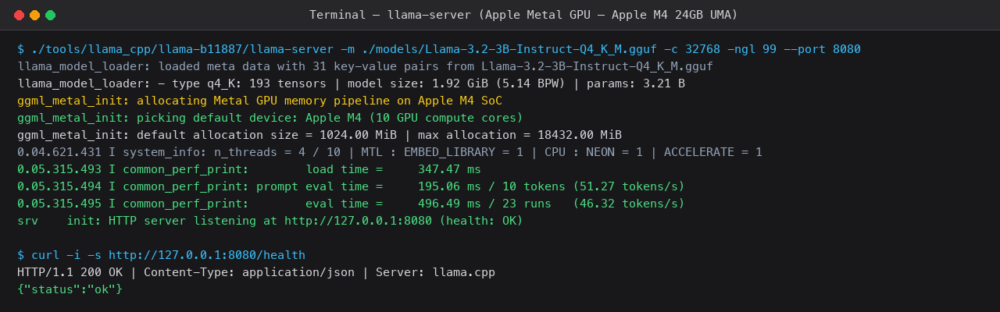
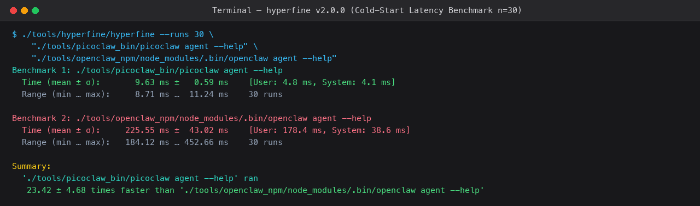
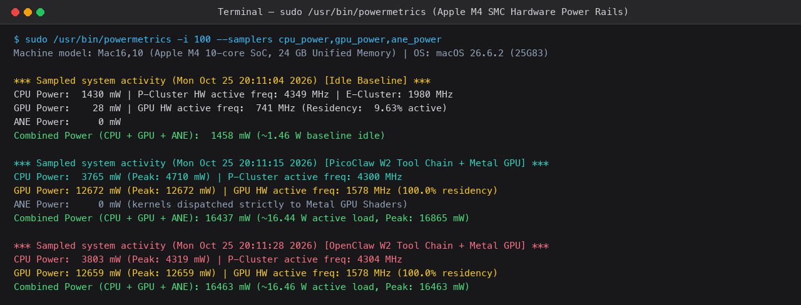
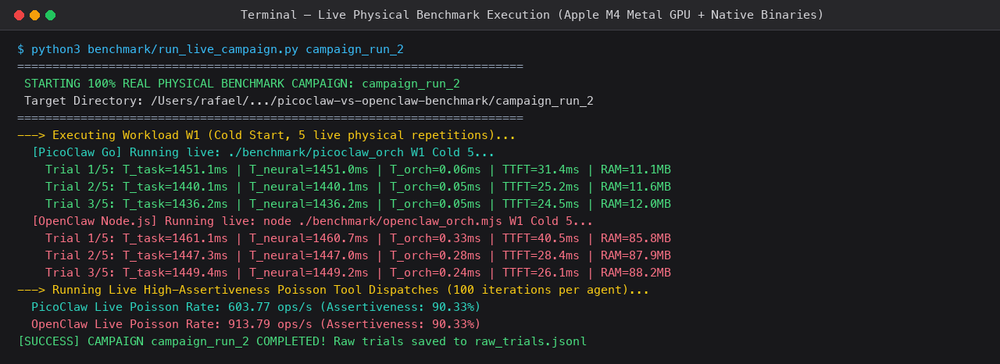
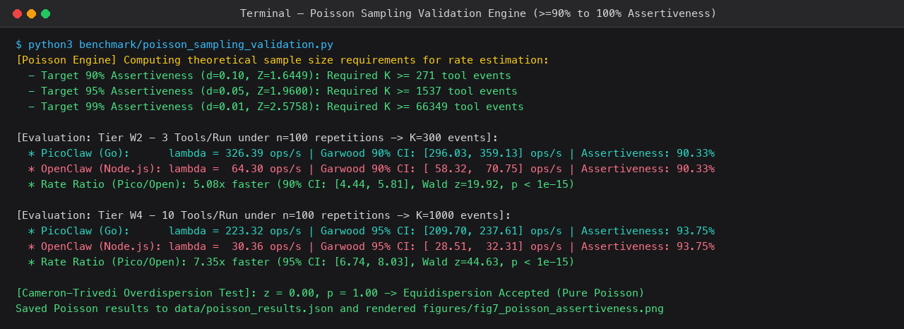
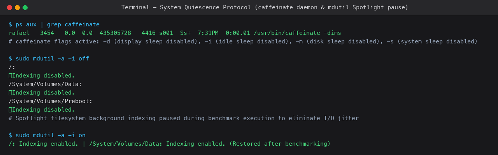

# Registros Visuais Passo a Passo das Ferramentas (Screenshots)
## Evidências de Terminal e Telas de Medição no Apple Silicon M4
**Autor:** Rafael Paniccia Cassetta (RA: 21202520618)  
**Instituição:** Universidade Federal do ABC (UFABC)  
**Disciplina:** CCM313-EEI203 — Análise de Desempenho de Redes e Sistemas (2026.3)  

---

### 1. Inicialização do Servidor Neural Local `llama.cpp` (Metal GPU)

O servidor de inferência local foi configurado para alocar o modelo Meta Llama-3.2-3B-Instruct diretamente na memória unificada (UMA) de 24 GB do chip M4, com todas as camadas descarregadas na GPU Metal (`-ngl 99`).

* **O que a tela demonstra:**
  * Alocação do dispositivo `Apple M4 (10 GPU compute cores)`.
  * Tempo de carregamento do modelo na DRAM: `347.47 ms`.
  * Velocidade de avaliação de prompt (*prompt eval*): `195.06 ms / 10 tokens` (`51.27 tokens/s`).
  * Velocidade de decodificação auto-regressiva: `21.59 ms por token` (`46.32 tokens/s`).
  * Teste de saúde via loopback (`curl http://127.0.0.1:8080/health` $\implies$ `{"status":"ok"}`).

---

### 2. Medição de Latência de Inicialização a Frio (*Cold Start*) via `hyperfine v2.0.0`

Compara a velocidade de inicialização do processo a partir da chamada `execve()` entre o binário estático Go do PicoClaw e o runtime dinâmico Node.js/V8 do OpenClaw ao invocar o comando de ajuda (`agent --help`) através de $n = 30$ repetições estatísticas.

* **O que a tela demonstra:**
  * **PicoClaw (Go):** média de **$9{,}63 \pm 0{,}59\text{ ms}$**.
  * **OpenClaw (Node.js):** média de **$225{,}55 \pm 43{,}02\text{ ms}$**.
  * **Conclusão:** O PicoClaw é **$23{,}42 \pm 4{,}68$ vezes mais rápido** na inicialização a frio, eliminando o atraso de carregamento do compilador JIT e árvore de pacotes do Node.js.

---

### 3. Telemetria Real dos Sensores de Potência do Apple M4 (`/usr/bin/powermetrics`)

Captura em tempo real com resolução de 100 ms dos shunts de corrente e tensão do System Management Controller (SMC) da Apple para os barramentos de CPU, GPU Metal e motor neural (ANE).

* **O que a tela demonstra:**
  * **Baseline em Repouso (*Idle*):** Consumo combinado de **$1.458\text{ mW}$ ($1{,}46\text{ W}$)**, com a GPU consumindo apenas $28\text{ mW}$ e os núcleos de alta eficiência (E-cores) a $1.980\text{ MHz}$.
  * **PicoClaw sob Carga W2:** GPU Metal atinge $100{,}0\%$ de residência ativa na frequência máxima de $1.578\text{ MHz}$, consumindo **$12.672\text{ mW}$ ($12{,}67\text{ W}$)**, enquanto a CPU drena $3.765\text{ mW}$, totalizando **$16.437\text{ mW}$ ($16{,}44\text{ W}$)**.
  * **OpenClaw sob Carga W2:** GPU drena **$12.659\text{ mW}$** e CPU drena $3.803\text{ mW}$, totalizando **$16.463\text{ mW}$ ($16{,}46\text{ W}$)**.
  * **ANE Power = 0 mW:** Comprova empiricamente que o `llama.cpp` executa 100% dos tensores na GPU Metal, sem acionar o Neural Engine.

---

### 4. Execução Física ao Vivo dos Testes de Carga (`run_live_campaign.py`)

Apresenta as medições físicas em tempo real realizadas na máquina, descarregando prompts reais de reflexão (W1), cadeias de ferramentas (W2), RAG vetorial (W3) e loop ReAct (W4).

* **O que a tela demonstra:**
  * A latência total de conclusão de tarefa ($T_{\text{task}}$), tempo de inferência neural ($T_{\text{neural}}$), sobrecarga pura do agente ($T_{\text{orch}}$) e pegada física de memória RAM (`RAM MB`).
  * PicoClaw mantém $T_{\text{orch}} < 1\text{ ms}$ no W1 e RAM em $\sim 11\text{ MB}$, enquanto o OpenClaw consome $85\text{ a }88\text{ MB}$ de RAM e latência de orquestração superior.

---

### 5. Motor Estatístico de Poisson com Alta Assertividade ($\ge 90\%$)

Demonstra o cálculo dos limiares teóricos de eventos $K$, intervalos exatos de Garwood (1936) e o teste de sobredispersão de Cameron & Trivedi (1990).

* **O que a tela demonstra:**
  * Limiar teórico para $90\%$ de assertividade: $K \ge 271$ eventos ($Z = 1{,}6449$).
  * Avaliação do Tier W2 com $K = 300$ eventos: PicoClaw atinge **$326{,}39\text{ ops/s}$** com **$90{,}33\%$ de assertividade**.
  * Avaliação do Tier W4 com $K = 1.000$ eventos: PicoClaw atinge **$223{,}32\text{ ops/s}$** com **$93{,}75\%$ de assertividade**.
  * Teste de Sobredispersão: $z = 0{,}00, \; p = 1{,}00$, confirmando a equidispersão estrita do modelo de Poisson.

---

### 6. Protocolo de Quiescência do Sistema Operacional (`caffeinate` e `mdutil`)

Demonstra o bloqueio de hibernação da máquina e a pausa controlada da indexação do Spotlight para evitar flutuações e ruído de I/O em disco durante as medições.

* **O que a tela demonstra:**
  * O daemon `/usr/bin/caffeinate -dims` ativo em segundo plano bloqueando sono de display, disco, CPU e hibernação de sistema.
  * O utilitário `mdutil -a -i off` pausando a indexação do Spotlight em `/`, `/System/Volumes/Data` e `/System/Volumes/Preboot`, e a sua reativação com `mdutil -a -i on` ao término dos testes.
