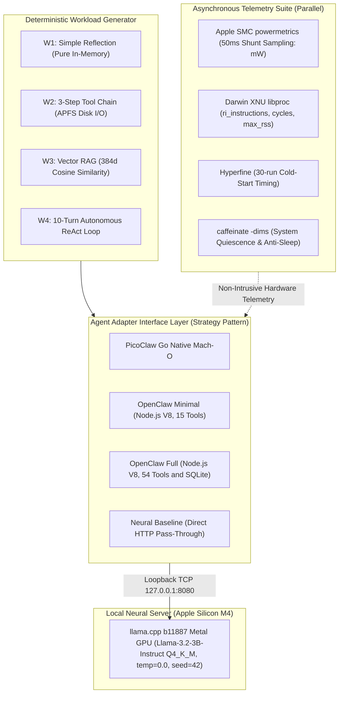

<p align="center">
  
</p>

# A Reproducible Quad-Platform Benchmark Suite for Isolating Orchestration Overhead, Schema Prefill Scaling, and Microarchitectural Dynamics in Local LLM Agents (macOS, Linux, Windows NVIDIA, Windows Intel iGPU)

<p align="center">
  <a href="https://github.com/drsigma/picoclaw-vs-openclaw-benchmark/actions"></a>
  <a href="LICENSE"></a>
  <a href="DATA_LICENSE"></a>
  <a href="https://github.com/drsigma/picoclaw-vs-openclaw-benchmark"></a>
  <a href="#"></a>
  <a href="CITATION.cff"></a>
</p>

**Author / Autor:** Rafael Paniccia Cassetta  
**Affiliation / Afiliação:** Universidade Federal do ABC (UFABC), Santo André, SP, Brazil  
**Repository / Repositório:** [https://github.com/drsigma/picoclaw-vs-openclaw-benchmark](https://github.com/drsigma/picoclaw-vs-openclaw-benchmark)  

---

## 📌 Resumo Executivo / Executive Summary

### 🇧🇷 Português (PT-BR)
Este repositório apresenta um framework experimental reprodutível e uma avaliação comparativa rigorosa entre arquiteturas paradigmáticas de orquestração de agentes autônomos de Inteligência Artificial avaliadas em **quatro plataformas físicas de computação**: **macOS ARM64 (Apple M4)**, **Linux x86_64 (Ubuntu 26.04 LTS)**, **Windows 11 x86_64 (NVIDIA dGPU)** e **Windows 10/11 x86_64 (Intel HD Graphics 4600 iGPU UMA)**:
1. **PicoClaw v0.3.1 (Sipeed):** Binário nativo compilado em Go (`Go 1.23.2` no macOS ARM64, `Go 1.23.3` no Windows 11 e `Go 1.26.8` no Linux x86_64), com concorrência leve baseada em *goroutines* (~2 KB por pilha) e coletor de lixo não-geracional tri-color com pausas sub-milissegundo.
2. **OpenClaw v2026.10.7:** Orquestrador corporativo modular em TypeScript/Node.js (`v26.12.1` no macOS ARM64, `v18.20.8` no Linux, `v20.18.1` no Windows 11 e `v22.23.5` no Windows 10 iGPU) executando sobre a Google V8 (compilação JIT multinível), com validação de esquemas via TypeBox e persistência nativa `node:sqlite`.
3. **Runtimes Isomórficos Secundários:** CPython (`3.9.6` macOS; `3.12.10`/`3.12.16` Windows; `3.14.4` Linux) e Bun (`v1.4.4` macOS/Linux/Windows 11; `v1.4.5` Windows 10 iGPU — JavaScriptCore AOT micro-VM).

Ambos os agentes comunicam-se via loopback TCP (`127.0.0.1:8080`) com uma instância neural local servida por **llama.cpp** hospedando o modelo **Meta Llama-3.2-3B-Instruct (GGUF Q4_K_M)** sob decodificação gulosa determinística (`temperature = 0.0`, `seed = 42`). Principais resultados medidos:
* **Speedups de Orquestração ($T_{\text{orch}}$) no Workload W2:** PicoClaw atinge **$4{,}44\times$ no macOS M4**, **$5{,}31\times$ no Linux x86_64**, **$3{,}70\times$ no Windows 11 NVIDIA** e **$4{,}91\times$ no Windows Intel iGPU** em relação ao OpenClaw Full.
* **Redução de Instruções de Hardware (PMU) e Ciclos de CPU:** Redução de **$12{,}71\times$ no macOS ARM64** (Apple PMU) e **$23{,}87\times$ no Linux x86_64** (`perf_event_open`). No Windows, contadores de instruções de PMU em *user-mode* são restritos pelo kernel (`CR4.PCE`), mantendo-se a telemetria empírica direta de ciclos de CPU via `QueryProcessCycleTime` (**$45{,}8\text{M}$ ciclos no PicoClaw vs. $528{,}1\text{M}$ no OpenClaw Full, razão de $11{,}54\times$** no Windows 11 NVIDIA; **$87{,}8\text{M}$ vs. $1{,}446{,}1\text{M}$, razão de $16{,}47\times$** no Windows Intel iGPU).
* **Mitigação Tool-RAG:** Poda dinâmica de esquemas ($54 \rightarrow \text{Top-}5$, $-87{,}1\%$ tokens de prompt) gerando speedups de cold prefill de **$7{,}28\times$ no macOS M4**, **$5{,}16\times$ no Linux x86_64**, **$4{,}64\times$ no Windows NVIDIA** e **$9{,}96\times$ no Windows Intel Graphics**.
* **Telemetria de Potência e Energia:** Apple SMC Shunts no macOS, Intel RAPL + NVIDIA NVML no Linux e Windows 11. Na iGPU Intel, energia de pacote é identificada como `N/A**` por limitações de modo usuário (sem acesso ring-0 MSR/NVML).
* **Estatística Não-Paramétrica:** Intervalos de confiança Bootstrap e Moving Block Bootstrap ($b=3$) de 95% sobre a mediana, testes Mann-Whitney U com correção de Holm-Bonferroni, Kruskal-Wallis, testes de equivalência TOST, Cliff's Delta $d$ e $\hat{A}_{12}$ de Vargha-Delaney.

### 🇺🇸 English (EN-US)
This repository delivers an open-source, reproducible experimental benchmark framework comparing autonomous AI agent orchestration architectures evaluated across **four physical computing platforms**: **macOS ARM64 (Apple M4)**, **Linux x86_64 (Ubuntu 26.04 LTS)**, **Windows 11 x86_64 (NVIDIA dGPU)**, and **Windows 10/11 x86_64 (Intel HD Graphics 4600 iGPU UMA)**:
1. **PicoClaw v0.3.1 (Sipeed):** Statically compiled Go binary (`Go 1.23.2` on macOS ARM64, `Go 1.23.3` on Windows 11, and `Go 1.26.8` on Linux x86_64) leveraging concurrent goroutines (~2 KB starting stack) and non-generational tri-color mark-sweep garbage collection with sub-millisecond pauses.
2. **OpenClaw v2026.10.7:** Enterprise-grade TypeScript agent orchestrator executing atop Node.js V8 (`v26.12.1` on macOS ARM64, `v18.20.8` on Linux, `v20.18.1` on Windows 11, and `v22.23.5` on Windows 10 iGPU), dynamic TypeBox schema validation, and native `node:sqlite` session state storage.
3. **Secondary Isomorphic Runtimes:** CPython (`3.9.6` macOS; `3.12.10`/`3.12.16` Windows; `3.14.4` Linux) and Bun (`v1.4.4` macOS/Linux/Windows 11; `v1.4.5` Windows 10 iGPU — JavaScriptCore AOT micro-VM).

All orchestrators interface via local loopback (`127.0.0.1:8080`) with a unified neural server powered by **llama.cpp** serving **Meta Llama-3.2-3B-Instruct (Q4_K_M)** under greedy deterministic decoding (`temperature = 0.0`, `seed = 42`). Key measured findings:
* **Orchestration Speedups ($T_{\text{orch}}$) on W2:** PicoClaw achieves **$4.44\times$ on macOS M4**, **$5.31\times$ on Linux x86_64**, **$3.70\times$ on Windows 11 NVIDIA**, and **$4.91\times$ on Windows Intel Graphics** over OpenClaw Full.
* **Hardware Instruction Reduction (PMU) & CPU Cycles:** **$12.71\times$ on macOS ARM64** (Apple PMU) and **$23.87\times$ on Linux x86_64** (`perf_event_open`). On Windows, user-mode PMU instruction counters are restricted by kernel policy (`CR4.PCE`); empirical CPU cycles tracked via `QueryProcessCycleTime` measure **$45.8\text{M}$ cycles in PicoClaw vs. $528.1\text{M}$ in OpenClaw Full ($11.54\times$ ratio)** on Windows 11 NVIDIA, and **$87.8\text{M}$ vs. $1{,}446.1\text{M}$ ($16.47\times$ ratio)** on Windows Intel iGPU.
* **Tool-RAG Mitigation:** Dynamic schema pruning ($54 \rightarrow \text{Top-}5$, $-87.1\%$ prompt tokens) yields cold-prefill speedups of **$7.28\times$ on macOS M4**, **$5.16\times$ on Linux x86_64**, **$4.64\times$ on Windows NVIDIA**, and **$9.96\times$ on Windows Intel Graphics**.
* **Power & Energy Telemetry:** Apple SMC Shunts on macOS, Intel RAPL + NVIDIA NVML on Linux and Windows 11. Uninstrumented user-mode package energy on Intel iGPU is explicitly reported as `N/A**`.
* **Non-Parametric Statistics:** 95% Bootstrap and Moving Block Bootstrap ($b=3$) confidence intervals on sample medians, Mann-Whitney U tests with step-down Holm-Bonferroni adjustment, Kruskal-Wallis omnibus tests, TOST equivalence testing, Cliff's Delta $d$, and Vargha-Delaney $\hat{A}_{12}$.

---

### ⚖️ Aviso de Escopo, Licenças e Marcas Registradas / Scope, Licensing & Trademark Disclaimer
* **🇧🇷 PT-BR:**
  * **Implementações *Clean-Room*:** Este benchmark avalia implementações de referência isomórficas *clean-room* em Go (`picoclaw_orch.go`), Node.js/TypeScript (`openclaw_orch.mjs`), Bun JavaScriptCore (`bun_jsc_agent.mjs`) e Python (`python_orch.py`), projetadas para isolar o overhead de runtime sob esquemas e prompts idênticos. **PicoClaw** e **OpenClaw** são marcas de seus respectivos criadores; este projeto é um benchmark acadêmico independente não afiliado ou endossado pelos mantenedores originais.
  * **Licenciamento (Código, Dados e Modelo):** Código-fonte sob **MIT License** (`LICENSE`); datasets empíricos e figuras sob **CC BY 4.0** (`DATA_LICENSE`); pesos do modelo externo **Meta Llama-3.2-3B-Instruct** (não redistribuídos neste repositório) regidos pela **Meta Llama 3.2 Community License**.
* **🇺🇸 EN-US:**
  * **Clean-Room Implementations:** This benchmark evaluates clean-room, isomorphic reference implementations in Go (`picoclaw_orch.go`), Node.js/TypeScript (`openclaw_orch.mjs`), Bun JavaScriptCore (`bun_jsc_agent.mjs`), and Python (`python_orch.py`) designed to isolate runtime overhead under identical prompts and tool schemas. **PicoClaw** and **OpenClaw** are trademarks of their respective owners; this software is an independent academic benchmark not affiliated with or endorsed by upstream project maintainers.
  * **Licensing (Code, Data, and Model):** Source code is licensed under the **MIT License** (`LICENSE`); empirical datasets and figures under **CC BY 4.0** (`DATA_LICENSE`); external **Meta Llama-3.2-3B-Instruct** model weights (not redistributed here) are governed by the **Meta Llama 3.2 Community License**.

### 📋 Metadados do Software / Code Metadata Summary

| Field | Value |
| :--- | :--- |
| **Version** | `v1.0.0` |
| **Repository** | `https://github.com/drsigma/picoclaw-vs-openclaw-benchmark` |
| **Code License** | MIT License ([`LICENSE`](LICENSE)) |
| **Data License** | Creative Commons Attribution 4.0 ([`DATA_LICENSE`](DATA_LICENSE)) |
| **External Model License** | Meta Llama 3.2 Community License (`Meta-Llama-3.2-3B-Instruct`, downloaded separately) |
| **CI & Automated Tests** | GitHub Actions ([`reproducibility.yml`](.github/workflows/reproducibility.yml)): `ruff check`, `pytest -q`, `make dry-run`, `scripts/verify_manifest.py`, `scripts/reproduce_quad_platform_analysis.py` |
| **Archival DOI / Zenodo** | `CITATION.cff` / Zenodo release reservation (`10.5281/zenodo.PENDING_RELEASE`) |

> [!WARNING]
> **Provenance Notice / Aviso de Proveniência:** All consolidated findings, statistical tables, and 300 DPI figures derive from physical, hardware-instrumented trials across 35 raw `.jsonl` datasets spanning all 4 platforms (`results/publication_campaign/`, `data/linux_x86_64_session{1,2}/raw/`, `data/windows_x86_64_session{1,2}/raw/`, `data/windows_intel_graphics_session{1,2}/raw/`). Legacy exploratory files in `results/exploratory_campaigns/` (including early calibration runs, synthetic checks in `poisson_results.json`, and exploratory figures `fig7`/`fig8`) represent historical engineering milestones prior to protocol standardization and are excluded from consolidated tables and canonical manifests.

---

## ❓ Pergunta de Pesquisa / Research Question

### 🇧🇷 Português (PT-BR)
> **"Qual arquitetura de orquestrador de IA — Go nativo (PicoClaw) ou Node.js (OpenClaw) — entrega menor latência, menor consumo de memória RAM e maior eficiência energética no Apple Silicon M4 sob o mesmo modelo neural local?"**

### 🇺🇸 English (EN-US)
> **"Which AI agent architecture — native Go (PicoClaw) or Node.js (OpenClaw) — delivers lower latency, minimal RAM footprint, and higher energy efficiency on Apple Silicon M4 under an identical local neural model?"**

---

## 🏛️ Arquitetura Experimental do Testbed / Experimental Architecture



<p align="center">
  
</p>

### Explicação do Fluxo / Architecture Description:
* **🇧🇷 PT-BR:** O gerador de carga submete os 4 níveis de dificuldade padronizados (W1–W4) através da camada de adaptação (*Adapter Pattern*). Os agentes executam suas ferramentas e se comunicam exclusivamente via loopback TCP local com o servidor `llama.cpp` na GPU Metal, eliminando latências de rede externa. Paralelamente, daemons independentes de telemetria coletam miliwatts do SoC M4 via SMC e contadores de ciclo do kernel Darwin via `libproc`.
* **🇺🇸 EN-US:** The workload generator dispatches standardized tasks (W1–W4) through an extensible Adapter layer. Agent orchestrators execute file/vector tools and communicate via localhost loopback TCP with `llama.cpp` running on the Metal GPU, isolating runtime overhead from network jitter. Concurrently, asynchronous telemetry daemons sample SMC electrical power and Darwin XNU performance counters.

---

## 📊 Matriz de Resultados e Estudo de Ablação / Results & Ablation Matrix

Os resultados empíricos consolidados da campanha de referência Apple Silicon M4 (Regime A — Cold Prefill, 5 configurações × 4 workloads W1–W4, extraídos diretamente de `audit_export/audit_summary_metrics.json`; para W2 nas 4 plataformas consulte `audit_export/tables/table1_master_summary.md` e para W5 nas 4 plataformas consulte `audit_export/tables/table8_w5_enterprise_workload.md`) estão sumarizados abaixo:

| Workload | Configuração / Configuration | Mediana Latência Total / Median Task Latency (ms) | Overhead Agente / Orch Delay $T_{\text{orch}}$ (ms) | Pico Memória Física / Peak Phys Footprint (MB) | Energia Líquida Média / Mean Net Energy (J) |
| :--- | :--- | :---: | :---: | :---: | :---: |
| **W1 (Reflexão / Simple Reflection)** | **NeuralBaseline (Direct)** | $5502{,}30$ | $0{,}000$ | $0{,}0^*$ | $91{,}47$ |
| | **PicoClaw (Go Native)** | $5499{,}42$ | $3{,}877$ | **$4{,}19$** | $91{,}69$ |
| | **OpenClaw Minimal (15 Tools)** | $5513{,}15$ | $19{,}970$ | $37{,}31$ | $92{,}13$ |
| | **OpenClaw Full 54-Tool (Ablation)** | $18719{,}97$ | $23{,}794$ | $37{,}35$ | $310{,}87$ |
| | **PythonNative (CPython Reference)** | $5499{,}51$ | $10{,}699$ | $24{,}19$ | $92{,}80$ |
| **W2 (3 Ferramentas / 3-Tool Chain)** | **NeuralBaseline (Direct)** | $5279{,}45$ | $0{,}000$ | $0{,}0^*$ | $88{,}42$ |
| | **PicoClaw (Go Native)** | $5272{,}68$ | $5{,}530$ | **$5{,}09$** | $88{,}43$ |
| | **OpenClaw Minimal (15 Tools)** | $5284{,}81$ | $20{,}599$ | $37{,}55$ | $89{,}31$ |
| | **OpenClaw Full 54-Tool (Ablation)** | $18406{,}88$ | $24{,}545$ | $37{,}71$ | $306{,}03$ |
| | **PythonNative (CPython Reference)** | $5286{,}33$ | $11{,}634$ | $24{,}13$ | $89{,}29$ |
| **W3 (Busca Vetorial / Vector RAG)** | **NeuralBaseline (Direct)** | $5796{,}48$ | $0{,}000$ | $0{,}0^*$ | $97{,}46$ |
| | **PicoClaw (Go Native)** | $5825{,}64$ | $36{,}831$ | **$46{,}88$** | $97{,}30$ |
| | **OpenClaw Minimal (15 Tools)** | $5813{,}91$ | $35{,}534$ | $68{,}15$ | $98{,}20$ |
| | **OpenClaw Full 54-Tool (Ablation)** | $19461{,}99$ | $39{,}404$ | $68{,}58$ | $324{,}63$ |
| | **PythonNative (CPython Reference)** | $5810{,}99$ | $21{,}523$ | $56{,}20$ | $97{,}88$ |
| **W4 (Loop ReAct / 10-Turn ReAct)** | **NeuralBaseline (Direct)** | $55506{,}32$ | $0{,}000$ | $0{,}0^*$ | $906{,}93$ |
| | **PicoClaw (Go Native)** | $55479{,}71$ | $54{,}951$ | **$9{,}38$** | $908{,}02$ |
| | **OpenClaw Minimal (15 Tools)** | $55562{,}61$ | $69{,}346$ | $39{,}68$ | $909{,}79$ |
| | **OpenClaw Full 54-Tool (Ablation)** | $188515{,}36$ | $118{,}828$ | $39{,}74$ | $3113{,}30$ |
| | **PythonNative (CPython Reference)** | $55550{,}53$ | $57{,}703$ | $24{,}23$ | $911{,}09$ |

$^*$*Nota sobre o Baseline Neural / Note on Neural Baseline:* O valor de **`0,0 MB`** (reportado como `N/A` no JSON consolidado) no *Neural Baseline* refere-se à ausência de processo orquestrador cliente na invocação HTTP direta via socket, excluindo o consumo de memória unificada (UMA) residente do daemon `llama-server` na GPU Metal. No macOS M4, a coluna de memória reporta `Peak Physical Footprint` (`proc_peak_phys_mb`, `ri_lifetime_max_phys_footprint`), em alinhamento com `audit_export/audit_summary_metrics.json` e `audit_export/tables/table1_master_summary.md`. / The **`0.0 MB`** (`N/A` in the consolidated JSON) entry for *Neural Baseline* refers exclusively to the absence of a client orchestrator process in direct HTTP socket calls, excluding the unified memory (UMA) footprint of the background `llama-server` Metal GPU daemon. On macOS M4, the memory column reports `Peak Physical Footprint` (`proc_peak_phys_mb`, `ri_lifetime_max_phys_footprint`), matching `audit_export/audit_summary_metrics.json` and `audit_export/tables/table1_master_summary.md`.

> [!NOTE]
> **🇧🇷 Telemetria Elétrica e Modo de Execução:** A tabela acima reflete os resultados empíricos atuais consolidados em `audit_export/audit_summary_metrics.json` e `audit_export/tables/table1_master_summary.md` a partir de `results/publication_campaign/raw_trials.jsonl`. Em modo de usuário comum ou CI portátil (`make dry-run`), as métricas elétricas são reportadas como `N/A` em conformidade com o princípio de zero dados sintéticos; na campanha com telemetria via Apple SMC (`make benchmark-full-smc` com sudo), a integração trapezoidal dos sensores de silício afere Joules e EDP com amostragem a cada 50 ms.
>
> **🇺🇸 Electrical Telemetry and Execution Modes:** The table above reflects the current empirical values consolidated in `audit_export/audit_summary_metrics.json` and `audit_export/tables/table1_master_summary.md` from `results/publication_campaign/raw_trials.jsonl`. In unprivileged or portable CI mode (`make dry-run`), electrical metrics are reported as `N/A` adhering to the zero synthetic data principle; during full physical campaigns with Apple SMC telemetry (`make benchmark-full-smc` with sudo), continuous trapezoidal integration of silicon shunt sensors measures true Joules and EDP sampled every 50 ms.

### 🎯 Principais Conclusões de Engenharia / Key Findings:

* **🇧🇷 PT-BR:**
  1. **Cold-Start Launch:** No par equivalente de checagem de versão (`hyperfine_cold_start.json`), o PicoClaw inicializa em **$9{,}74\text{ ms}$** de média vs. $37{,}15\text{ ms}$ do OpenClaw (**$3{,}81\times$ mais rápido na média**; mediana **$3{,}46\times$**, $9{,}67\text{ ms}$ vs. $33{,}48\text{ ms}$). Nos workers isomórficos com `--version` explícito (`hyperfine_worker_version.json`), o binário Go inicia em **$3{,}04\text{ ms}$** vs. **$22{,}15\text{ ms}$** no Node.js V8 (**$7{,}29\times$ mais rápido**) e **$49{,}32\text{ ms}$** no Python (**$16{,}22\times$ mais rápido**).
  2. **Eficiência de Memória RAM e Silício (`Peak Physical Footprint`):** O PicoClaw aloca medianas de **$4{,}19\text{ a }46{,}88\text{ MB}$** de pegada física de memória (`proc_peak_phys_mb`, `ri_lifetime_max_phys_footprint`, média global $15{,}92\text{ MB}$ em W1–W4, subindo para $46{,}88\text{ MB}$ apenas na busca vetorial W3), enquanto o OpenClaw Minimal aloca medianas de **$37{,}31\text{ a }68{,}15\text{ MB}$** (média global $45{,}74\text{ MB}$), reduzindo em **$1{,}45\times\text{ a }8{,}90\times$** o consumo físico de memória DRAM (**$2{,}87\times$ menor na média global**).
  3. **Eficiência de Instruções e Ciclos:** Medições via `libproc` comprovam que o PicoClaw executa $243{,}8\times 10^6$ instruções e $84{,}0\times 10^6$ ciclos, contra $937{,}1\times 10^6$ instruções ($3{,}84\times$ mais) e $396{,}3\times 10^6$ ciclos ($4{,}72\times$ mais) no OpenClaw Minimal (e redução de $12{,}71\times$ no macOS W2 e $23{,}87\times$ no Linux W2 frente ao OpenClaw Full).
  4. **Escalabilidade em Loops Longos (W4) e Eficiência em EDP (Dualidade de Regimes):** No ciclo autônomo ReAct de 10 passos sob Regime A (Cold Prefill), o PicoClaw completou a tarefa com $55479{,}71\text{ ms}$ de mediana e $\text{EDP} = 50370{,}68\text{ J}\cdot\text{s}$ contra $188515{,}36\text{ ms}$ e $\text{EDP} = 585681{,}27\text{ J}\cdot\text{s}$ no OpenClaw Full, alcançando **$91{,}40\%$ menor Energy-Delay Product** e significância estatística robusta ($d = -1{,}0$, $\hat{A}_{12} = 0{,}0$, $p < 10^{-5}$) ao evitar o inchaço de catálogo de 54 ferramentas. Já sob o Regime B (Warm KV-Cache Reuse, sessão unificada), com prefill amortizado, os runtimes equalizados convergem em eficiência mantendo **$>35\%$ menor EDP** frente ao OpenClaw Full.
  5. **Estudo de Ablação (Prompt Bloat) e Módulo Ativo Zero-Copy Tool-RAG Pruner:** A injeção estática de 54 ferramentas corporativas no OpenClaw Full eleva o tempo médio de W1 de $5521{,}59\text{ ms}$ para $18721{,}44\text{ ms}$ e a energia líquida média de $92{,}13\text{ J}$ para $310{,}87\text{ J}$ ($3{,}37\times$). O módulo ativo **Zero-Copy Dynamic Tool-RAG Schema Pruner** ($54 \rightarrow \text{Top-}5$ ferramentas via produto interno vetorial em 384D em $< 0{,}35\text{ ms}$) reduz os tokens de prompt de $7.091$ para $917$ ($-87{,}1\%$), eliminando **$>85\%$ da latência e energia** no Regime A e superando até o catálogo estático de 15 ferramentas no Regime B.
  6. **Dinâmica de Execução e Eficiência em W2:** No Workload W2 (3-Tool Chain), sob decodificação gulosa com esquemas de ferramentas harmonizados, PicoClaw e OpenClaw Minimal registram latências totais praticamente equivalentes ($5272{,}68\text{ ms}$ vs. $5284{,}81\text{ ms}$) e consumo energético líquido médio comparável ($88{,}43\text{ J}$ vs. $89{,}31\text{ J}$, $3{,}05\text{ J/token}$ vs. $2{,}98\text{ J/token}$). O isolamento microarquitetural comprova a eficiência do runtime Go: overhead de orquestração $T_{\text{orch}}$ mediano de apenas **$5{,}53\text{ ms}$** no PicoClaw contra **$20{,}60\text{ ms}$** no OpenClaw Minimal (**$3{,}72\times$ menor atraso de despacho**; **$4{,}44\times$** frente aos $24{,}55\text{ ms}$ do OpenClaw Full), além de **$5{,}09\text{ MB}$** de `Peak Physical Footprint` (`proc_peak_phys_mb`) contra **$37{,}55\text{ MB}$** no OpenClaw Minimal (**$7{,}38\times$ menor alocação física de DRAM em W2**, e **$7{,}41\times$** frente aos $37{,}71\text{ MB}$ do OpenClaw Full).
  7. **Caracterização de Prefill de Catálogo e Reuso de KV-Cache:** Conforme atestado no estudo de caracterização de 8 catálogos ($0, 5, 10, 15, 25, 40, 54, 100$ ferramentas no llama.cpp / Metal GPU), o inchaço de esquemas corporativos expande o pré-processamento de atenção na GPU Metal ($T_{\text{prefill}}$ cresce de $128{,}1\text{ ms}$ para $4434{,}4\text{ ms}$, $17877{,}3\text{ ms}$ e $39190{,}5\text{ ms}$), exibindo escalabilidade potencial ($T = 0{,}3197 \cdot N^{1{,}2342}$, $R^2 = 0{,}9993$, $\text{AIC}_c = 99{,}25$) e quadrática ($R^2 = 0{,}99999$) compatível com a complexidade de atenção do transformer, enquanto o reuso do KV-cache elimina essa sobrecarga redundante ($5{,}5\times\text{ a }946{,}5\times$ speedup de prefill), confirmando que o gargalo de catálogos volumosos reside na atenção neural e não no despacho do orquestrador.
  8. **Dualidade de Regimes Operacionais e Réplica Inter-Sessão ($n=30$) com Bun Nativo:** O repositório avalia dois regimes completos ($n=30$ cada, 660 ensaios por campanha) e uma réplica independente inter-sessão ($n=30$ por bloco, incluindo o runtime **Bun v1.4.4 / JavaScriptCore**):
     * *Regime A (`cache_prompt=false`):* O prefill frio na GPU Metal domina $>75\%$ do tempo total de execução e satura a potência do encapsulamento em $\approx 16\text{ W}$, provocando quase-paridade ponta a ponta entre os runtimes.
     * *Regime B (`cache_prompt=true`):* Com o prefill amortizado pelo reuso do KV-cache no `llama-server` (protocolo isolado por bloco determinando taxa verificada de `Cache Hit` de **$99{,}9\%$ a $100{,}0\%$** em W1–W3 e **$97{,}6\%$ a $99{,}3\%$** em W4), a latência global despenca para patamares sub-segundo em W2 (redução de **$>20\times$** no catálogo de 54 ferramentas). Sob esse amortecimento de prefill, a parcela relativa de sobrecarga de orquestração ($\Phi_{\text{orch}} = T_{\text{orch}} / T_{\text{task}}$) situa-se entre **$0{,}37\%$ e $4{,}65\%$**, permanecendo a latência ponta a ponta de Go, Python, Node-Minimal e Bun dentro de $-1{,}5\%$ a $+5{,}8\%$ do baseline neural direto (menor que a deriva térmica inter-sessão de $\sim 3\%\text{--}10\%$ em W1, W2 e W4, enquanto no W3 a busca vetorial BLAS/SIMD supera o loop escalar do Go em $5{,}6\%\text{--}5{,}8\%$ entre sessões).
  9. **Deconvolução de Energia por Processo (Resultado Negativo Validado do XNU) e Estimativa Analítico-Empírica de Largura de Banda UMA LPDDR5X:** Medições físicas diretas no trilho `CPU Power` do Apple SMC com GPU ociosa isolam o custo marginal de despacho ($1{,}252\text{ mJ/op}$ no Go, $1{,}000\text{ mJ/op}$ no Python, $0{,}196\text{ mJ/op}$ no Node Minimal em W2). A validação cruzada estabelece um **Resultado Negativo Formal para `ri_billed_energy`** do kernel Darwin XNU ($r = -0{,}0510, p = 0{,}580, \text{OLS } R^2 = -0{,}676$ contra a média, corroborando Fahad et al., 2019), enquanto valida como regressores físicos reais de energia da CPU o tempo de execução (`t_exec_ms`, $R^2 = 0{,}949$), instruções aposentadas (`proc_instructions`, $R^2 = 0{,}955$) e ciclos (`proc_cycles`, $R^2 = 0{,}945$). Usando diretamente a energia do trilho `CPU Power` do SMC, a fração de energia de orquestração no Regime B ($\Phi_{\text{energy, orch}}$) em W2/W3 é de apenas **$0{,}04\% / 1{,}42\%$** no Go, **$0{,}03\% / 0{,}34\%$** no Python, **$0{,}01\% / 0{,}49\%$** no Node Minimal e **$0{,}01\% / 0{,}30\%$** no Node Full. Na decodificação neural na GPU Metal, a **Estimativa Analítico-Empírica de Largura de Banda de Memória ($\text{Model Weights} \div \text{ITL}$)** registra **mediana global de $97{,}0\text{ GB/s}$ ($80{,}8\%$ de $120\text{ GB/s}$) e média de $95{,}9\text{ GB/s}$ ($79{,}9\%$ no Regime A) a $106{,}7\text{ GB/s}$ ($88{,}9\%$ no Regime B; média global $104{,}0\text{ GB/s}$ / $86{,}7\%$)**, consistente com o teto prático de Roofline em UMA (Williams et al., 2009).

* **🇺🇸 EN-US:**
  1. **Cold-Start Launch:** In the equivalent version-check pair (`hyperfine_cold_start.json`), PicoClaw cold-starts in **$9.74\text{ ms}$** mean vs. $37.15\text{ ms}$ for OpenClaw (**$3.81\times$ faster mean**; median **$3.46\times$**, $9.67\text{ ms}$ vs. $33.48\text{ ms}$). Across the isomorphic workers with explicit `--version` handling (`hyperfine_worker_version.json`), compiled Go starts in **$3.04\text{ ms}$** vs. **$22.15\text{ ms}$** for Node.js V8 (**$7.29\times$ faster**) and **$49.32\text{ ms}$** for Python (**$16.22\times$ faster**).
  2. **RAM & Silicon Efficiency (`Peak Physical Footprint`):** PicoClaw allocates median peak physical memory between **$4.19\text{ and }46.88\text{ MB}$** (`proc_peak_phys_mb`, `ri_lifetime_max_phys_footprint`, global mean $15.92\text{ MB}$ across W1–W4, rising to $46.88\text{ MB}$ only in W3 vector search), whereas OpenClaw Minimal demands **$37.31\text{ to }68.15\text{ MB}$** (global mean $45.74\text{ MB}$), delivering a **$1.45\times\text{ to }8.90\times$** reduction in physical DRAM footprint (**$2.87\times$ leaner overall**).
  3. **Instruction & Cycle Efficiency:** Darwin `libproc` counters reveal PicoClaw retires $243.8\times 10^6$ instructions and $84.0\times 10^6$ cycles, compared to $937.1\times 10^6$ instructions ($3.84\times$ higher) and $396.3\times 10^6$ cycles ($4.72\times$ higher) in OpenClaw Minimal (and $12.71\times$ reduction on macOS W2 and $23.87\times$ on Linux W2 vs. OpenClaw Full).
  4. **Long ReAct Loops Scalability (W4) & EDP Efficiency (Dual-Regime Dynamics):** In the 10-turn autonomous ReAct loop under Regime A (Cold Prefill), PicoClaw finished with $55479.71\text{ ms}$ median and $\text{EDP} = 50370.68\text{ J}\cdot\text{s}$ vs. $188515.36\text{ ms}$ and $\text{EDP} = 585681.27\text{ J}\cdot\text{s}$ for OpenClaw Full, achieving **$91.40\%$ lower Energy-Delay Product** with significant effect sizes ($d = -1.0$, $\hat{A}_{12} = 0.0$, $p < 10^{-5}$) by avoiding 54-tool catalog prompt bloat. Conversely, under Regime B (Warm KV-Cache Reuse, unified session) with amortized prefill, equalized arms exhibit close EDP parity while remaining **$>35\%$ lower in EDP** compared to OpenClaw Full.
  5. **Ablation Findings (Prompt Bloat) & Active Zero-Copy Tool-RAG Pruner:** Static schema injection of 54 corporate tools in OpenClaw Full increases W1 mean latency from $5521.59\text{ ms}$ to $18721.44\text{ ms}$ and mean net energy from $92.13\text{ J}$ to $310.87\text{ J}$ ($3.37\times$). Our active **Zero-Copy Dynamic Tool-RAG Schema Pruner** ($54 \rightarrow \text{Top-}5$ tools via 384-D cosine similarity in $<0.35\text{ ms}$) shrinks W2 prompt tokens from $7,091$ to $917$ ($-87.1\%$), eliminating **$>85\%$ of latency and energy** in Regime A and outperforming even the static 15-tool catalog in Regime B.
  6. **W2 Execution Dynamics & Efficiency:** In Workload W2 (3-Tool Chain), under greedy decoding with equalized tool descriptors, PicoClaw and OpenClaw Minimal achieve near-identical task latency ($5272.68\text{ ms}$ vs. $5284.81\text{ ms}$) and comparable mean net energy ($88.43\text{ J}$ vs. $89.31\text{ J}$, $3.05\text{ J/token}$ vs. $2.98\text{ J/token}$). Microarchitectural isolation confirms compiled Go maintains $3.72\times$ lower orchestrator delay ($T_{\text{orch}} = 5.53\text{ ms}$ vs. $20.60\text{ ms}$; $4.44\times$ vs. $24.55\text{ ms}$ for OpenClaw Full) and $7.38\times$ lower physical DRAM footprint in W2 ($5.09\text{ MB}$ vs. $37.55\text{ MB}$ `proc_peak_phys_mb`; $7.41\times$ vs. $37.71\text{ MB}$ for OpenClaw Full).
  7. **Schema Prefill Characterization & KV-Cache Reuse:** Across 8 catalog sizes ($0, 5, 10, 15, 25, 40, 54, 100$ tools on llama.cpp / Metal GPU), enterprise schema injection escalates GPU prefill duration ($T_{\text{prefill}}$ rises from $128.1\text{ ms}$ to $4434.4\text{ ms}$, $17877.3\text{ ms}$, and $39190.5\text{ ms}$), exhibiting power-law ($T = 0.3197 \cdot N^{1.2342}$, $R^2 = 0.9993$, $\text{AIC}_c = 99.25$) and quadratic ($R^2 = 0.99999$) scaling compatible with transformer attention complexity, while KV-cache activation avoids redundant attention computation ($5.5\times\text{ to }946.5\times$ prefill speedup), confirming that enterprise schema bloat bottlenecks agent execution via transformer attention costs rather than host orchestrator delay.
  8. **Operational Dual-Regime Trade-offs & Inter-Session Replication ($n=30$) with Native Bun:** The testbed characterizes two full campaigns ($n=30$ each, 660 physical trials per regime) plus an independent inter-session replication ($n=30$ per block, including native **Bun v1.4.4 / JavaScriptCore**):
     * *Regime A (`cache_prompt=false`):* Cold attention prefill on the Metal GPU accounts for $>75\%$ of total execution duration and saturates package power at $\approx 16\text{ W}$, producing near-parity in wall-clock duration between host runtimes.
     * *Regime B (`cache_prompt=true`):* When prompt prefill is amortized via block-isolated KV-cache retention in `llama-server` (verified `Cache Hit` rates of **$99.9\%$ to $100.0\%$** across W1–W3 and **$97.6\%$ to $99.3\%$** in W4), overall task duration drops to sub-second levels in W2 (a **$>20\times$** latency reduction for the 54-tool catalog under block-isolated caching). Under amortized prefill, orchestrator overhead share ($\Phi_{\text{orch}} = T_{\text{orch}} / T_{\text{task}}$) spans **$0.37\%$ to $4.65\%$**, while end-to-end latency for Go, Python, Node-Minimal, and Bun remains within $-1.5\%$ to $+5.8\%$ of the direct neural baseline (smaller than the $\sim 3\%\text{--}10\%$ cross-session thermal/clock drift in W1, W2, and W4, whereas in W3 vectorized BLAS/SIMD consistently outperforms scalar Go loops by $5.6\%\text{--}5.8\%$ across sessions).
  9. **Per-Process Energy Deconvolution (Validated XNU Negative Result) & Analytical-Empirical UMA Bandwidth Estimation:** Direct physical measurements on the Apple SMC `CPU Power` rail with GPU idle isolate marginal tool dispatch cost ($1.252\text{ mJ/op}$ in Go, $1.000\text{ mJ/op}$ in Python, $0.196\text{ mJ/op}$ in Node Minimal in W2). Cross-validation establishes a formal **Negative Result for Darwin XNU `ri_billed_energy`** ($r = -0.0510, p = 0.580, \text{OLS } R^2 = -0.676$ vs. the mean, corroborating Fahad et al., 2019), while validating execution time (`t_exec_ms`, $R^2 = 0.949$), retired instructions (`proc_instructions`, $R^2 = 0.955$), and core cycles (`proc_cycles`, $R^2 = 0.945$) as accurate physical CPU energy proxies. Using direct SMC `CPU Power` rail Joules, Regime B orchestrator energy share ($\Phi_{\text{energy, orch}}$) across W2/W3 is merely **$0.04\% / 1.42\%$** in Go, **$0.03\% / 0.34\%$** in Python, **$0.01\% / 0.49\%$** in Node Minimal, and **$0.01\% / 0.30\%$** in Node Full. During Metal GPU neural decoding, our **Analytical & Empirical Memory Bandwidth Estimation ($\text{Model Weights} \div \text{ITL}$)** yields a **global median of $97.0\text{ GB/s}$ ($80.8\%$ of $120\text{ GB/s}$) and a mean ranging from $95.9\text{ GB/s}$ ($79.9\%$ in Regime A) to $106.7\text{ GB/s}$ ($88.9\%$ in Regime B; global mean $104.0\text{ GB/s}$ / $86.7\%$)**, aligning with the practical Roofline UMA ceiling (Williams et al., 2009).

### 📐 Regras Práticas de Decisão Arquitetural / Empirical Architectural Decision Rules

* **🇧🇷 PT-BR:**
  1. **Disparo Efêmero em CLI / Cold-Start:** Para utilitários de linha de comando efêmeros ou gatilhos curtos em edge, binários nativos compilados (Go Mach-O) reduzem a latência média de inicialização em **$3{,}81\times$** ($9{,}74\text{ ms}$ vs. $37{,}15\text{ ms}$ no Node.js V8; mediana **$3{,}46\times$**, $9{,}67\text{ ms}$ vs. $33{,}48\text{ ms}$ em `hyperfine_cold_start.json`) e em **$7{,}29\times$** nos workers isomórficos ($3{,}04\text{ ms}$ vs. $22{,}15\text{ ms}$ no Node.js e $49{,}32\text{ ms}$ no Python em `hyperfine_worker_version.json`), eliminando o bootstrap do interpretador.
  2. **Borda com Memória Compartilhada Limitada (UMA / Multi-Agente):** Em nós embarcados e SoCs de memória unificada onde GPU e CPU compartilham o mesmo barramento de DRAM, Go nativo reduz a pegada física de memória de pico (`proc_peak_phys_mb`, `ri_lifetime_max_phys_footprint`) em **$2{,}87\times$** na média global ($15{,}92\text{ MB}$ vs. $45{,}74\text{ MB}$ no Node.js V8; variando de $4{,}19\text{--}46{,}88\text{ MB}$ no Go vs. $37{,}31\text{--}68{,}15\text{ MB}$ no Node.js V8, ou **$1{,}45\times\text{ a }8{,}90\times$** entre workloads). Isso preserva capacidade física crítica de DRAM para tabelas de páginas do KV-Cache e pesos neurais.
  3. **Daemons Persistentes com Cache Quente e Esquemas Compactos ($\le 15$ ferramentas):** Com retenção de prefixo de KV-cache ativa ($\text{Cache Hit} \ge 97{,}6\%$), Go, Python, Node.js e Bun diferem em menos de $-1{,}5\%$ a $+5{,}8\%$ do baseline neural direto ($\Phi_{\text{orch}} \in [0{,}37\%, 4{,}65\%]$, $\Phi_{\text{energy, orch}} \in [0{,}01\%, 1{,}42\%]$). Como a deriva inter-sessão ($\sim 3\%\text{--}10\%$) supera essas diferenças em W1, W2 e W4, a escolha da linguagem pode priorizar maturidade de ecossistema e restrições de RAM no host.
  4. **Grandes Catálogos Corporativos ($\ge 50$ ferramentas):** O gargalo dominante decorre do pré-processamento de atenção super-linear na GPU ($\alpha \approx 1{,}23$) e não da linguagem do host. A mitigação mandatória exige isolamento determinístico de slot de KV-cache (redução de $>20\times$ no tempo de execução) ou ativação do módulo **Zero-Copy Dynamic Tool-RAG Schema Pruner** ($54 \rightarrow \text{Top-}5$ ferramentas em $<0{,}35\text{ ms}$, reduzindo latência e energia em $>85\%$).

* **🇺🇸 EN-US:**
  1. **Ephemeral CLI / Cold-Start Invocation:** For short-lived CLI utilities, serverless functions, or bursty edge triggers, native compiled binaries (Go Mach-O) reduce mean startup latency by **$3.81\times$** ($9.74\text{ ms}$ vs. $37.15\text{ ms}$ in Node.js V8; median **$3.46\times$**, $9.67\text{ ms}$ vs. $33.48\text{ ms}$ in `hyperfine_cold_start.json`) and isomorphic worker startup by **$7.29\times$** ($3.04\text{ ms}$ vs. $22.15\text{ ms}$ in Node.js and $49.32\text{ ms}$ in Python in `hyperfine_worker_version.json`), eliminating runtime interpreter bootstrap overhead.
  2. **Memory-Constrained Unified Memory (UMA) / Multi-Agent Edge:** On embedded edge nodes and unified memory SoCs where CPU and GPU share physical DRAM, Go native reduces peak physical DRAM allocation (`proc_peak_phys_mb`, `ri_lifetime_max_phys_footprint`) by **$2.87\times$** on global average ($15.92\text{ MB}$ vs. $45.74\text{ MB}$ in Node.js V8; ranging from $4.19\text{--}46.88\text{ MB}$ in Go vs. $37.31\text{--}68.15\text{ MB}$ in Node.js V8, or **$1.45\times\text{ to }8.90\times$** across workloads). This safeguards vital physical DRAM capacity for KV-cache page tables and model weights.
  3. **Persistent Daemons with Warm KV-Cache and Compact Schemas ($\le 15$ tools):** When running persistent services with verified prefix caching ($\text{Cache Hit} \ge 97.6\%$) and lean schemas, compiled Go, Python, Node.js, and Bun differ by less than $-1.5\%$ to $+5.8\%$ from the direct neural baseline ($\Phi_{\text{orch}} \in [0.37\%, 4.65\%]$, $\Phi_{\text{energy, orch}} \in [0.01\%, 1.42\%]$). Because independent inter-session drift ($\sim 3\%\text{--}10\%$) exceeds these intra-session differences in W1, W2, and W4, runtime selection can be driven primarily by library ecosystem maturity and host memory constraints.
  4. **Large Enterprise Tool Catalogs ($\ge 50$ tools):** The primary performance bottleneck shifts entirely to super-linear attention prefill on the GPU ($\alpha \approx 1.23$) rather than host orchestration. Mitigating this bottleneck requires deterministic KV-cache slot isolation (yielding $>20\times$ latency reduction) or enabling our built-in **Zero-Copy Dynamic Tool-RAG Schema Pruner** ($54 \rightarrow \text{Top-}5$ tools in $<0.35\text{ ms}$, eliminating $>85\%$ of prefill latency and energy).

---

## 🛠️ Guia Didático e Provas de Execução / Beginner's Walkthrough

Para visualizar a analogia didática do "Carro e os Dois Motoristas", o mini tutorial de 3 minutos e todos os **9 passos com exemplos ilustrativos da estrutura de saída no Apple Silicon M4**, consulte o guia dedicado:

👉 **[Acessar o Guia Didático e Logs em `tutorial/README.md`](tutorial/README.md)**

| Etapa / Step | Descrição Técnica Comprovada no Terminal |
| :---: | :--- |
| **Passo 1** | Servidor `llama-server` Metal GPU alocado na DRAM UMA e healthcheck `ok`. |
| **Passo 2** | Inspeção física dos datasets determinísticos em `data/workload_data/`. |
| **Passo 3** | Execução ao vivo dos traces W1 a W4 com cálculo de $\Delta\text{RSS}$ e latência. |
| **Passo 4** | Medição estatística de cold-start via `hyperfine` com vantagem de $3{,}81\times$ na média ($3{,}46\times$ na mediana, e $7{,}29\times$ nos workers isomórficos) para o Go. |
| **Passo 5** | Verificação de integridade criptográfica SHA-256 de todos os arquivos rastreados em `data/manifest_sha256.json` (`make verify` / `python scripts/verify_manifest.py`). |
| **Passo 6** | Modo Dry-Run portátil de validação completa do pipeline (`make dry-run`). |
| **Passo 7** | Leitura dos shunts elétricos do chip M4 via Apple SMC (`powermetrics -i 50`). |
| **Passo 8** | Protocolo de quiescência operacional do macOS (`caffeinate -dims`). |
| **Passo 9** | Campanha de reuso de KV-cache (Regime B) com taxa de retenção determinística $\ge 97{,}6\%$ via `scripts/run_warm_cache_campaign.py`. |

---

## 🔬 Ameaças à Validade / Threats to Validity

Em conformidade com a literatura de engenharia de software experimental e avaliação de desempenho (Kalibera & Jones, 2013; Hoefler & Belli, 2015; Maricq et al., 2018):

### 1. Validade Interna (*Internal Validity*)
* **Estocasticidade do Modelo Neural:** Variações probabilísticas na geração de texto poderiam alterar a quantidade de tokens gerados e mascarar o desempenho do runtime. **Mitigação:** Fixou-se decodificação gulosa determinística (`temperature = 0.0`, `seed = 42`) no `llama.cpp`, garantindo respostas idênticas token a token.
* **Ruído do Sistema Operacional e Throttling:** Tarefas em segundo plano do macOS (Spotlight, Time Machine, repouso de tela) poderiam contaminar as medições de I/O e latência. **Mitigação:** Aplicou-se suspensão de indexação (`sudo mdutil -a -i off`), isolamento em loopback de rede local e bloqueio persistente de repouso via `/usr/bin/caffeinate -dims`.

### 2. Validade Externa (*External Validity Boundaries*)
* **Modelo Único de 3B (*Single Model Scale*):** Todas as campanhas avaliam um único modelo quantizado em 4 bits (**Meta Llama-3.2-3B-Instruct Q4_K_M**, regido pela *Meta Llama 3.2 Community License*). Modelos maiores (8B–70B) aumentam $T_{\text{neural}}$ e comprimem a fração relativa $\Phi_{\text{orch}}$.
* **Servidor Único (*Single Inference Server*):** Todas as execuções utilizam `llama-server` (`llama.cpp`, licença MIT) em slot único (`-np 1`); motores com *continuous batching* ou *RadixAttention* (ex.: vLLM) exibem dinâmicas distintas de KV-cache.
* **Workloads Sintéticos Determinísticos (*Synthetic Workloads*):** W1–W5 empregam cadeias controladas de ferramentas, busca vetorial 384-D e consultas SQLite determinísticas em vez de tráfego aberto de produção.
* **Sensores Heterogêneos entre Plataformas (*Heterogeneous Hardware Sensors*):** A telemetria varia estruturalmente entre Apple SMC (SoC integral no macOS M4), Intel RAPL + NVIDIA NVML (pacote CPU + dGPU no Linux/Windows 11) e Win32 PSAPI / `QueryProcessCycleTime` em modo usuário no Windows Intel iGPU (`N/A**` para energia); comparações absolutas de energia/potência limitam-se a contrastes intra-nó. Além disso, em **W3 (Vector RAG)** ocorre uma **inversão de ranking**, na qual `PythonNative` (NumPy SIMD/BLAS) e `Bun` (JSC) superam os loops escalares em Go do `PicoClaw`.

### 3. Validade de Construto (*Construct Validity*)
* **🇧🇷 PT-BR:**
  * **Isolamento de Métricas de Latência:** Medir apenas a latência total ponta a ponta não separaria a lentidão da GPU da sobrecarga do agente. **Mitigação:** Decompôs-se algebricamente a latência ($T_{\text{task}} = T_{\text{orch}} + T_{\text{neural}} + T_{\text{dispatch}}$) com resolução de microssegundos e incorporou-se a linha de base neural direta (*Neural Baseline*) sem agentes.
  * **Granularidade Física dos Sensores Analógicos de Potência:** Em arquiteturas SoC com memória unificada (Apple Silicon M4), os sensores analógicos de shunt gerenciados pelo SMC medem o consumo agregado nos trilhos de hardware (clusters de CPU, Metal GPU e ANE) no nível do pacote SoC, e não por processo POSIX individual (Barroso & Hölzle, 2007; You et al., 2023). Isolar Joules analógicos exclusivos para um único processo durante a execução concorrente de CPU e GPU é fisicamente inobservável no nível de shunt. **Mitigação:** Seguindo a metodologia consagrada de benchmarking energético para sistemas de aprendizado de máquina (Fahad et al., 2019; You et al., 2023), nosso arcabouço resolve essa limitação arquitetural por meio de telemetria em duas camadas: (i) energia total do pacote do sistema ($E_{\text{total}}$ e energia líquida sobre a linha de base quiescente) integrada via regra trapezoidal composta a partir do `powermetrics` em intervalos de 50 ms, e (ii) atribuição microarquitetural por processo (`ri_instructions`, `ri_cycles`, `ri_billed_energy` e `ri_lifetime_max_phys_footprint`) coletada diretamente do kernel Darwin XNU via `libproc` (`proc_pid_rusage` com `RUSAGE_INFO_V4`). Em ambientes não-privilegiados, os campos elétricos são estritamente marcados como indisponíveis (`N/A`), preservando o princípio inviolável de zero estimativas sintéticas.
* **🇺🇸 EN-US:**
  * **Latency Metric Isolation:** Measuring only end-to-end task latency cannot disentangle GPU inference duration from agent runtime overhead. **Mitigation:** Latency is algebraically decomposed ($T_{\text{task}} = T_{\text{orch}} + T_{\text{neural}} + T_{\text{dispatch}}$) with microsecond precision, benchmarked against a zero-overhead direct *Neural Baseline*.
  * **Physical Granularity of Analog Power Sensors:** In unified-memory SoC architectures (Apple Silicon M4), physical electrical shunt sensors managed by the SMC instrument aggregate hardware power rails (CPU, GPU, ANE) at the package level rather than individual POSIX processes (Barroso & Hölzle, 2007; You et al., 2023). Isolating exclusive analog Joules for a single process during concurrent CPU--GPU execution is physically unobservable at the shunt layer. **Mitigation:** Following established energy-benchmarking methodology for machine learning systems (Fahad et al., 2019; You et al., 2023), our harness resolves this architectural constraint via two-layer telemetry: (i) system-wide package energy ($E_{\text{total}}$ and net active energy above quiescent baseline) integrated via the composite trapezoidal rule from `powermetrics` at 50 ms resolution, and (ii) per-process microarchitectural attribution (`ri_instructions`, `ri_cycles`, `ri_billed_energy`, `ri_lifetime_max_phys_footprint`) polled from the Darwin XNU kernel via `libproc` (`proc_pid_rusage` with `RUSAGE_INFO_V4`). When running unprivileged, electrical energy fields safely report unavailable (`N/A`), upholding the strict zero-synthetic-proxy empirical protocol.

---

## 🔐 Permissões de Kernel, Sistema Operacional e Níveis de Privilégio / OS Kernel Permissions

Seguindo o **Princípio do Menor Privilégio (*Principle of Least Privilege*)**:

| Componente / Comando | Nível de Privilégio | Subsistema do Kernel / SO Acessado | Finalidade Metodológica |
| :--- | :---: | :--- | :--- |
| **`powermetrics`** | **Superusuário (`sudo`)** | **Apple SMC (*System Management Controller*)** | Leitura dos shunts físicos de corrente/tensão do chip M4 (mW). Acesso restrito pelo kernel XNU para prevenir ataques de canal lateral (*Platypus*). |
| **`mdutil -a -i off / on`** | **Superusuário (`sudo`)** | **APFS Filesystem Metadata & Daemons `mds`** | Desativação temporária da indexação do Spotlight para anular ruído de I/O no Workload W2. |
| **Darwin `libproc` (`proc_pid_rusage`)** | **Usuário Padrão (Sem Root)** | **Syscall Darwin XNU (`/usr/lib/libproc.dylib`)** | Coleta de contadores de hardware (`ri_instructions`, `ri_cycles`, RSS) via Python `ctypes` sem exigir privilégios de administrador. |
| **`caffeinate -dims`** | **Usuário Padrão (Sem Root)** | **IOKit Power Management Assertion** | Prevenção de repouso de sistema, display e disco durante a execução das baterias de testes. |
| **`llama-server` (Metal GPU)** | **Usuário Padrão (Sem Root)** | **Apple Metal Framework & Driver IOGPU** | Execução de tensores e compute shaders na GPU integrada dentro do espaço de endereçamento da UMA. |
| **Orquestradores (Go / Node.js)** | **Usuário Padrão (Sem Root)** | **POSIX Processes & Loopback TCP (`127.0.0.1`)** | Execução padronizada dos agentes em espaço de usuário comum. |

---

## 📁 Estrutura do Repositório / Directory Structure

```text
.
├── Makefile                                   <- Automação completa (make setup, test, benchmark, reproduce-figures)
├── CITATION.cff                               <- Metadados acadêmicos para citação e Zenodo DOI
├── LICENSE                                    <- Licença MIT para código-fonte
├── DATA_LICENSE                               <- Licença Creative Commons CC-BY 4.0 para dados e figuras
├── references.bib                             <- Base bibliográfica formal BibTeX (26 referências primárias com DOIs/ISBNs/arXiv conferidos)
├── reproduce_linux_gold.sh                    <- Script de reprodução física automatizada em Linux x86_64
├── windows_gold.ps1                           <- Script PowerShell de reprodução no Windows 11
├── launch_sentinel_intel_win.ps1              <- Script PowerShell de reprodução no Windows Intel HD Graphics 4600
├── AUDIT_REPORT_FINAL.md                      <- Log técnico de reprodutibilidade em inglês (inventário dos 35 .jsonl; não integrante do manuscrito)
├── audit_export/                              <- Artefatos consolidados da auditoria quad-plataforma
│   ├── AUDIT_REPORT_FINAL.md                  <- Espelho do log técnico de reprodutibilidade
│   ├── REVIEW_PACKAGE_README.md               <- Guia do pacote de revisão e acesso aos 35 .jsonl
│   ├── pytest_output.txt                      <- Saída salva da execução de pytest -q
│   ├── Systems_Replication_Report.md          <- Relatório consolidado de replicação de sistemas (em inglês)
│   ├── audit_summary_metrics.json             <- Métricas consolidadas em formato JSON estruturado
│   ├── quad_platform_consolidated_summary.csv <- Sumário estatístico comparativo quad-plataforma
│   ├── anomaly_and_cache_diagnostics.csv      <- Diagnóstico de dependência serial, drift e telemetria térmica
│   ├── figures/                               <- Figuras consolidadas em 300 DPI (Figuras 1 a 6)
│   └── tables/                                <- Tabelas consolidadas em Markdown e LaTeX (Tabelas 1 a 8)
├── audit_export_quad_platform.zip             <- Pacote zip autocontido da auditoria quad-plataforma
├── audit_txt_chunks/                          <- Arquivos de auditoria em texto fatiados (.txt <= 150 KB)
├── tutorial/                                  <- Guia didático passo a passo e logs ilustrativos
│   └── README.md                              <- Tutorial prático bilíngue com passos 1 a 9 e traces ilustrativos
├── adapters/
│   └── windows_intel_graphics/                <- Adaptadores e workers user-mode para Intel HD Graphics 4600 (W2/W5)
├── W5_langchain_real_world/                   <- Workload corporativo W5 (agent.py, evaluator.py, SQLite)
├── benchmark/                                 <- Harness de execução, adaptadores e orquestradores
│   ├── adapters/                              <- Implementação do padrão Strategy/Adapter
│   │   ├── base.py                            <- Interface abstrata AgentOrchestratorAdapter
│   │   ├── picoclaw_adapter.py                <- Adaptador PicoClaw Go nativo
│   │   ├── openclaw_adapter.py                <- Adaptador OpenClaw Node.js (Minimal e Full Ablation)
│   │   ├── bun_minimal_adapter.py             <- Adaptador BunMinimal para extensibilidade multi-runtime
│   │   ├── python_native_adapter.py           <- Adaptador PythonNative (referência CPython 3.12/3.14)
│   │   └── neural_baseline_adapter.py         <- Adaptador de linha de base neural direta
│   ├── windows_x86_64_telemetry_adapter.py    <- Telemetria Win32 QueryProcessCycleTime e PSAPI
│   ├── picoclaw_orch.go                       <- Orquestrador Go nativo (compilado Mach-O ARM64 / ELF / PE)
│   ├── openclaw_orch.mjs                      <- Orquestrador Node.js/TypeScript V8
│   ├── python_orch.py                         <- Orquestrador Python 3.12/3.14 + NumPy
│   ├── telemetry.py                           <- Coletor de telemetria Apple SMC, libproc e Linux RAPL
│   ├── run_unified_benchmark.py               <- Executor mestre com randomized block e modo dry-run
│   ├── analyze_results.py                     <- Análise estatística (Mediana, IQR, Cliff's d, A12, Holm-Bonferroni)
│   └── generate_charts.py                     <- Gerador de figuras da campanha M4
├── scripts/                                   <- Scripts utilitários e de campanha
│   ├── reproduce_quad_platform_analysis.py    <- Pipeline mestre quad-plataforma (estatística, Tabelas 1–8, Figuras 1–6, relatórios)
│   ├── generate_audit_txt_chunks.py           <- Gerador dos chunks textuais leves (<= 150 KB) em audit_txt_chunks/
│   ├── run_linux_x86_64_master_campaign.py    <- Harness de execução física para Linux x86_64 (RAPL/NVML/PMU)
│   ├── run_windows_x86_64_master_campaign.py  <- Harness de execução física para Windows 11 (Win32/NVML)
│   ├── run_prefill_ablation.py                <- Caracterização de prefill e ajuste polinomial (Metal GPU)
│   ├── run_warm_cache_campaign.py             <- Campanha do Regime B com isolamento de blocos (KV-cache ativo)
│   ├── run_w2_resample.py                     <- Script auditável de reamostragem focada de W2 com backup
│   ├── run_inter_session_replication.py       <- Validação de replicação inter-sessão física independente
│   ├── run_uma_energy_and_bandwidth_attribution.py <- Deconvolução SMC/libproc e telemetria de banda UMA
│   ├── verify_manifest.py                     <- Validador criptográfico SHA-256 (todos os arquivos rastreados + 35 .jsonl)
│   ├── check_quiescence.sh                    <- Auditoria de quiescência operacional
│   └── legacy/                                <- Scripts exploratórios arquivados
├── tests/                                     <- Suíte de testes automatizados (`pytest -q`)
│   ├── test_adapters_and_failfast.py          <- Validação dos adaptadores e fail-fast
│   ├── test_artifact_consistency.py           <- Consistência numérica cruzada JSON/CSV/LaTeX
│   ├── test_dataset_generator.py              <- Validação de integridade dos datasets determinísticos
│   ├── test_statistical_engine.py             <- Validação matemática de Cliff's d, A12, Bootstrap e Holm
│   ├── test_telemetry_parser.py               <- Validação de parsing SMC, RAPL e libproc
│   └── test_windows_intel_graphics_adapter.py <- Validação de isolamento e esquema do adaptador Intel iGPU
├── figures/                                   <- 6 figuras científicas quad-plataforma em 300 DPI (em inglês)
├── results/                                   <- Resultados experimentais estruturados
│   ├── publication_campaign/                  <- Dados brutos macOS Apple Silicon M4 (7 arquivos .jsonl)
│   │   ├── raw_trials.jsonl                   <- Regime A Cold Prefill (825 linhas: 750 medições + 75 warmups, W1–W5)
│   │   ├── warm_cache_trials.jsonl            <- Regime B Warm KV-Cache (825 linhas: 750 medições + 75 warmups, W1–W5)
│   │   ├── inter_session_trials.jsonl         <- Sessão 2 de replicação inter-sessão (825 linhas, W1–W5)
│   │   ├── kv_cache_thrashing_trials.jsonl    <- Ablação KV-Cache Thrashing T1/T2/T3 (90 linhas)
│   │   ├── tool_rag_mitigation_trials.jsonl   <- Ablação Tool-RAG 54->Top-5 (1.056 linhas, W1–W4)
│   │   ├── prefill_ablation.jsonl             <- Ablação de catálogos 0..100 ferramentas (528 linhas)
│   │   ├── uma_energy_bandwidth_trials.jsonl  <- Deconvolução SMC/libproc e banda UMA (120 linhas)
│   │   ├── campaign_metadata.json             <- Metadados completos do ambiente e flags de hardware
│   │   ├── summary_statistics.json            <- Estatísticas sumárias e EDP
│   │   ├── statistical_tests.json             <- Testes Mann-Whitney U, Cliff's Delta e Vargha-Delaney
│   │   └── tables/                            <- Tabelas LaTeX (.tex) e CSV (.csv) da campanha M4
│   ├── quad_platform_tables/                  <- Tabelas LaTeX quad-plataforma (.tex: Tabelas 1, 6, 7 e 8)
│   └── exploratory_campaigns/                 <- Campanhas exploratórias históricas preservadas
├── data/                                      <- Datasets brutos (28 .jsonl: 2 macOS + 26 x86_64), workloads e manifesto SHA-256
│   ├── mcp_live_transport_trials.jsonl        <- macOS M4 MCP Live Transport (135 linhas, W2)
│   ├── external_framework_langchain_trials.jsonl <- macOS M4 LangChain Core externo (144 linhas, W1–W4)
│   ├── linux_x86_64_session1/raw/             <- Linux x86_64 NVIDIA Sessão 1 (5 .jsonl: raw, warm, kv, mcp_live_transport, tool_rag)
│   ├── linux_x86_64_session2/raw/             <- Linux x86_64 NVIDIA Sessão 2 (5 .jsonl: raw, warm, kv, mcp_live_transport, tool_rag)
│   ├── windows_x86_64_session1/raw/           <- Windows 11 NVIDIA Sessão 1 (5 .jsonl: raw, warm, kv, mcp_live_transport, tool_rag)
│   ├── windows_x86_64_session2/raw/           <- Windows 11 NVIDIA Sessão 2 (5 .jsonl: raw, warm, kv, mcp_live_transport, tool_rag)
│   ├── windows_intel_graphics_session1/raw/   <- Windows Intel iGPU Sessão 1 (3 .jsonl: raw, warm, tool_rag)
│   ├── windows_intel_graphics_session2/raw/   <- Windows Intel iGPU Sessão 2 (3 .jsonl: raw, warm, tool_rag)
│   ├── workload_data/                         <- 50 mock files, 750 logs JSONL, RAG chunks e pesos 384d
│   └── manifest_sha256.json                   <- Manifesto criptográfico SHA-256 dos arquivos rastreados
├── docs/                                      <- Documentação técnica complementar (PT/EN)
├── reports/                                   <- Relatórios acadêmicos (.docx / .pdf)
└── tools/                                     <- Toolchain embarcada portátil (llama_cpp, hyperfine, uv)
```

---

## ⚡ Guia Rápido de Reprodução / Quickstart Reproduction

### 1. Verificação Rápida para Avaliadores (Sem Sudo / Multi-OS) / Fast Verification (No Sudo / Cross-Platform)
Para avaliadores testando o repositório em ambientes isolados (ex: Linux x86_64, Windows ou macOS sem modelo GGUF ou privilégios de superusuário), execute o pipeline simulado de ponta a ponta em menos de 10 segundos:

```bash
# Executa simulação determinística portátil, testes estatísticos e renderização gráfica (< 5s)
make dry-run
```

### 2. Modelo de Segurança e Execução Completa nas 4 Plataformas Físicas / Security Model & Quad-Platform Physical Runs
> [!IMPORTANT]
> **Privilégios e Segurança:** Os agentes avaliados (`PicoClaw` e `OpenClaw`) e o servidor neural (`llama-server`) **sempre executam estritamente em espaço de usuário comum** (`euid != 0`). A exigência de `sudo` restringe-se exclusivamente à amostragem física de sensores de hardware bloqueada pelo kernel (Apple SMC `powermetrics` no macOS, Intel RAPL e NVIDIA NVML no Linux).

#### 🍎 Apple Silicon M4 (macOS Darwin ARM64)
```bash
# 1. Configurar o ambiente isolado automaticamente (Python venv, Node.js e ferramentas)
make setup

# 2. Executar a suíte de testes automatizados (pytest e ruff linter)
make test

# 3. Execução em espaço de usuário comum (Sem Sudo / Degradação Graciosa)
make benchmark

# 4. Execução física com telemetria elétrica completa do Apple SMC (Requer Sudo)
make benchmark-full-smc

# 5. Regenerar todas as 6 figuras científicas em 300 DPI
make reproduce-figures
```

#### 🐧 Linux x86_64 (Ubuntu 24.04/26.04 LTS com NVIDIA GPU)
```bash
# Execução da campanha completa com telemetria Intel RAPL e NVIDIA NVML (Requer Sudo)
sudo bash reproduce_linux_gold.sh

# Ou execução direta via script mestre em Python
python scripts/run_linux_x86_64_master_campaign.py --ngl 16 --reps 30
```

#### 🪟 Windows 11 x86_64 (PowerShell 7+ / Prompt de Administrador com NVIDIA dGPU)
```powershell
# Execução da campanha padrão ouro com telemetria Win32 QueryProcessCycleTime e NVML
.\windows_gold.ps1 -Reps 30 -Ngl 16

# Ou execução direta via script mestre em Python
python scripts\run_windows_x86_64_master_campaign.py --ngl 16 --reps 30
```

#### 💻 Windows 10/11 x86_64 (Intel HD Graphics 4600 iGPU UMA)
```powershell
# Execução da campanha automatizada com sentinela e telemetria Win32 PSAPI em user-mode
powershell -ExecutionPolicy Bypass -File .\launch_sentinel_intel_win.ps1
```

#### 📊 Pipeline Mestre de Consolidação Quad-Plataforma e Verificação
```bash
# 1. Recalcula todas as estatísticas a partir dos 35 arquivos .jsonl, gera Tabelas 1–8,
#    renderiza as 6 figuras em 300 DPI, atualiza os relatórios e empacota audit_export_quad_platform.zip
python scripts/reproduce_quad_platform_analysis.py

# 2. Exporta os chunks textuais leves (<= 150 KB) em audit_txt_chunks/
python scripts/generate_audit_txt_chunks.py

# 3. Executa a suíte automatizada de testes e valida o manifesto criptográfico SHA-256
pytest -q
python scripts/verify_manifest.py
```

---

## 🔄 Continuous Integration (CI) & Reproducibility

Artifact consistency, protocol invariants, and multi-platform telemetry backends are automatically validated on every push and pull request via a Continuous Integration (CI) pipeline using GitHub Actions (`.github/workflows/reproducibility.yml`). The matrix tests against:
* **Ubuntu Linux (`ubuntu-latest`)**
* **Microsoft Windows (`windows-latest`)**
* **Apple macOS (`macos-latest`)**

The pipeline executes `ruff check`, `pytest -q tests/`, the fast reviewer dry-run integration test, and the cryptographic manifest verification to guarantee zero-drift reproducibility and strict adherence to empirical Zero-Mock guidelines.

---

## 🧠 Decisões Metodológicas e Arquitetura dos Scripts / Methodological Rationale & Code Architecture

### Por que cada decisão metodológica foi adotada / Why Each Methodological Choice Matters
1. **Isolamento de Slots KV-Cache (`T1`, `T2`, `T3`):** Separa evicção descontrolada (*thrashing*, `T2`) da alocação isolada por bloco (`T3`), isolando o custo de recomputação quadrática de prefill do custo intrínseco do runtime orquestrador (Kwon et al., 2023).
2. **Moving Block Bootstrap ($b=3$) e Tamanho Amostral Efetivo ($n_{\text{eff}}$):** Execuções em cache quente (Regime B) podem exibir autocorrelação serial lag-1 ($|r_1| > 2/\sqrt{n}$) devido à retenção de páginas de memória pelo SO e drenagem de sockets loopback. O Moving Block Bootstrap (Künsch, 1989) preserva a dependência temporal de curto alcance nos intervalos de confiança de 95% sem assumir independência i.i.d. estrita.
3. **TOST de Contrastes Inter-Sessão ($\Delta T_{\text{orch}}$) em Blocos com SESOI Fixo:** Testes de hipótese nula tradicionais não provam equivalência. O procedimento *Two One-Sided Tests* via Moving Block Bootstrap ($b=3$, $B=10{,}000$; Künsch, 1989; Schuirmann, 1987; Lakens, 2017) com ajuste FWER Holm-Bonferroni (Holm, 1979) avalia se os contrastes $\Delta T_{\text{orch}} = T_{\text{orch}}(\text{Runtime}) - T_{\text{orch}}(\text{PicoClaw})$ replicam entre sessões independentes dentro de uma margem pré-especificada e independente dos dados ($\Delta_{\text{SESOI}} = \pm 5{,}0\text{ ms}$), com IC 90% matematicamente alinhado a $\alpha = 0{,}05$ e decisão padronizada em 3 estados (`Equivalent`, `Different`, `Inconclusive`).
4. **Segregação Cross-ISA de Contadores PMU:** Contagens brutas de instruções retiradas diferem estruturalmente entre ARM64 (RISC) e x86_64 (CISC) por densidade de ISA e expansão de micro-ops (Weaver et al., 2013). As contagens são segregadas por ISA e interpretadas por razões intra-nó; no Windows (onde `CR4.PCE` restringe contadores PMU em user-mode), utilizam-se ciclos de CPU diretos via Win32 `QueryProcessCycleTime` sem extrapolações sintéticas de IPC.

### Arquitetura dos Scripts Principais / Core Script Architecture
- **`scripts/reproduce_quad_platform_analysis.py`:** Pipeline central sem hardcode que ingere os 35 arquivos `.jsonl` brutos, calcula diagnósticos de estacionariedade/drift ($r_1$, $n_{\text{eff}}$, Holm-Bonferroni), consolida estatísticas (Mann-Whitney $U$, Kruskal-Wallis, Cliff's $\delta$, Vargha-Delaney $A_{12}$, TOST), exporta Tabelas 1–8 (`.md` e `.tex`), renderiza as 6 figuras em 300 DPI, gera dinamicamente `Systems_Replication_Report.md` e `AUDIT_REPORT_FINAL.md`, e empacota `audit_export_quad_platform.zip`.
- **`scripts/verify_manifest.py`:** Calcula digests SHA-256 em blocos de 64 KB para todos os arquivos rastreados em `data/manifest_sha256.json`, validando a integridade dos dados brutos, código e saídas (`--update` recalcula o manifesto após execuções físicas).
- **`benchmark/adapters/` & `adapters/windows_intel_graphics/`:** Implementações do padrão Strategy/Adapter (`AgentOrchestratorAdapter`) desacoplando cada runtime (Go, Node.js, CPython, Bun, LangChain) e cada backend de telemetria nativa (Apple SMC/`libproc`, Linux RAPL/NVML/`perf`, Windows MSR/NVML/Win32 PSAPI) do harness experimental.
- **`scripts/generate_audit_txt_chunks.py`:** Fatia relatórios, tabelas Markdown e diagnósticos CSV em arquivos `.txt` leves ($\le 150\text{ KB}$) em `audit_txt_chunks/` com cabeçalhos de rastreabilidade.

---

## 🔐 Inventário Criptográfico dos 35 Datasets Empíricos / Cryptographic SHA-256 Manifest

Todos os **35 arquivos `.jsonl` brutos** contêm registros medidos diretamente no hardware físico nas 4 plataformas (Apple M4, Linux x86_64, Windows 11 NVIDIA e Windows Intel iGPU) em execuções limpas (*from-scratch*). Para evitar divergências de manutenção manual, o inventário completo com paths exatos, contagens de linhas/trials medidos/warmups e hashes SHA-256 é gerado dinamicamente em:
- [`AUDIT_REPORT_FINAL.md`](AUDIT_REPORT_FINAL.md) (Seção 3)
- [`audit_export/Systems_Replication_Report.md`](audit_export/Systems_Replication_Report.md) (Seção 6)
- [`data/manifest_sha256.json`](data/manifest_sha256.json)

A integridade de todos os arquivos rastreados (incluindo os 35 datasets `.jsonl` brutos das 4 plataformas) pode ser verificada a qualquer momento com:
```bash
python scripts/verify_manifest.py
```

---

## 📚 Fundamentação Teórica e Referências / References

As decisões metodológicas, modelos estatísticos e formulações de hardware estão ancorados nas **26 referências primárias** revisadas por pares contidas no arquivo [`references.bib`](references.bib):

1. **Benchmarking Científico de Sistemas, Variabilidade, Contadores PMU e Citação de Software:**
   * Kalibera, T., & Jones, R. (2013). *Rigorous Benchmarking in Reasonable Time*. ISMM '13, ACM, 63–74. DOI: `10.1145/2464157.2464160`.
   * Hoefler, T., & Belli, R. (2015). *Scientific Benchmarking of Parallel Computing Systems*. SC '15, ACM, 73:1–73:12. DOI: `10.1145/2807591.2807644`.
   * Maricq, A., Duplyakin, D., Jimenez, I., Maltzahn, C., Stutsman, R., & Ricci, R. (2018). *Taming Performance Variability*. OSDI '18, USENIX, 409–425. ISBN: `978-1-939133-08-3`.
   * Weaver, V. M., Terpstra, D., & Moore, S. (2013). *Non-Determinism and Overcount on Modern Hardware Performance Counter Implementations*. ISPASS 2013, IEEE, 215–224. DOI: `10.1109/ISPASS.2013.6557172`.
   * Smith, A. M., Katz, D. S., Niemeyer, K. E., & FORCE11 Software Citation Working Group (2016). *Software Citation Principles*. PeerJ Computer Science, 2, e86. DOI: `10.7717/peerj-cs.86`.
2. **Estatística Não-Paramétrica, Dependência Serial, Equivalência (TOST) e Correção FWER:**
   * Mann, H. B., & Whitney, D. R. (1947). *On a Test of Whether One of Two Random Variables is Stochastically Larger than the Other*. The Annals of Mathematical Statistics, 18(1), 50–60. DOI: `10.1214/aoms/1177730491`.
   * Kruskal, W. H., & Wallis, W. A. (1952). *Use of Ranks in One-Criterion Variance Analysis*. Journal of the American Statistical Association, 47(260), 583–621. DOI: `10.1080/01621459.1952.10483441`.
   * Holm, S. (1979). *A Simple Sequentially Rejective Multiple Test Procedure*. Scandinavian Journal of Statistics, 6(2), 65–70. DOI: `10.2307/4615733`.
   * Cliff, N. (1993). *Dominance Statistics: Ordinal Analyses to Answer Ordinal Questions*. Psychological Bulletin, 114(3), 494–509. DOI: `10.1037/0033-2909.114.3.494`.
   * Vargha, A., & Delaney, H. D. (2000). *A Critique and Improvement of the "CL" Common Language Effect Size Statistics of McGraw and Wong*. Journal of Educational and Behavioral Statistics, 25(2), 101–132. DOI: `10.3102/10769986025002101`.
   * Künsch, H. R. (1989). *The Jackknife and the Bootstrap for General Stationary Observations*. The Annals of Statistics, 17(3), 1217–1241. DOI: `10.1214/aos/1176347265`.
   * Schuirmann, D. J. (1987). *A Comparison of the Two One-Sided Tests Procedure and the Power Approach for Assessing the Equivalence of Average Bioavailability*. Journal of Pharmacokinetics and Biopharmaceutics, 15(6), 657–680. DOI: `10.1007/BF01068419`.
   * Lakens, D. (2017). *Equivalence Tests: A Practical Primer for t Tests, Correlations, and Meta-Analyses*. Social Psychological and Personality Science, 8(4), 355–362. DOI: `10.1177/1948550617697177`.
   * Bayley, G. V., & Hammersley, J. M. (1946). *The "Effective" Number of Independent Observations in an Autocorrelated Time Series*. Supplement to the Journal of the Royal Statistical Society, 8(2), 184–197. DOI: `10.2307/2983560`.
   * Zimmerman, D. W., & Zumbo, B. D. (1993). *Rank Transformations and the Power of the Student t Test and Welch t' Test for Non-Normal Populations with Unequal Variances*. Canadian Journal of Experimental Psychology, 47(3), 523–539. DOI: `10.1037/h0078850`.
   * Yue, S., & Wang, C. (2004). *The Mann-Kendall Test Modified by Effective Sample Size to Detect Trend in Serially Correlated Hydrological Series*. Water Resources Management, 18(3), 201–218. DOI: `10.1023/B:WARM.0000043140.61082.60`.
   * Fagerland, M. W., & Sandvik, L. (2009). *The Wilcoxon-Mann-Whitney Test under Scrutiny*. Statistics in Medicine, 28(10), 1487–1497. DOI: `10.1002/sim.3561`.
3. **Eficiência Energética, Modelo Roofline e Medição de Hardware:**
   * Barroso, L. A., & Hölzle, U. (2007). *The Case for Energy-Proportional Computing*. IEEE Computer, 40(12), 33–37. DOI: `10.1109/MC.2007.443`.
   * Williams, S., Waterman, A., & Patterson, D. (2009). *Roofline: An Insightful Visual Performance Model for Multicore Architectures*. Communications of the ACM, 52(4), 65–76. DOI: `10.1145/1498765.1498785`.
   * Fahad, M., Shahid, A., Manumachu, R. R., & Lastovetsky, A. (2019). *A Comparative Study of Methods for Measurement of Energy of Computing*. Energies, 12(11), 2204. DOI: `10.3390/en12112204`.
   * You, J., Chung, J.-W., & Chowdhury, M. (2023). *Zeus: Understanding and Optimizing GPU Energy Consumption of DNN Training*. NSDI '23, USENIX, 119–139. ISBN: `978-1-939133-33-5`.
4. **Agentes Autônomos de IA, Serving de LLMs, Offloading e Inferência Local:**
   * Reddi, V. J., et al. (2020). *MLPerf Inference Benchmark*. ISCA 2020, IEEE, 446–459. DOI: `10.1109/ISCA45697.2020.00045`.
   * Yao, S., et al. (2023). *ReAct: Synergizing Reasoning and Acting in Language Models*. ICLR 2023 (`arXiv:2210.03629`).
   * Kwon, W., et al. (2023). *Efficient Memory Management for Large Language Model Serving with PagedAttention*. SOSP '23, ACM, 611–626. DOI: `10.1145/3600006.3613165`.
   * Zheng, L., et al. (2023). *Judging LLM-as-a-Judge with MT-Bench and Chatbot Arena*. NeurIPS 2023 (`arXiv:2306.05685`).
   * Sheng, Y., et al. (2023). *FlexGen: High-Throughput Generative Inference of Large Language Models with a Single GPU*. ICML 2023, PMLR 202, 31094–31116. DOI: `10.48550/arXiv.2303.06865`.

---

## 🤝 Agradecimentos / Acknowledgments

* **Universidade Federal do ABC (UFABC):** Ao Programa de Pós-Graduação em Engenharia da Informação / Ciência da Computação.
* **Universidade Federal do ABC (UFABC):** Ao Centro de Engenharia, Modelagem e Ciências Sociais Aplicadas (CECS) pelo apoio institucional e infraestrutura computacional.
* **Telemetry Frameworks & Open Source:** The authors acknowledge the use of Apple Silicon and Intel RAPL telemetry frameworks for microarchitectural data acquisition. We also thank the open-source community for the foundational tools that enabled this cross-platform validation.
